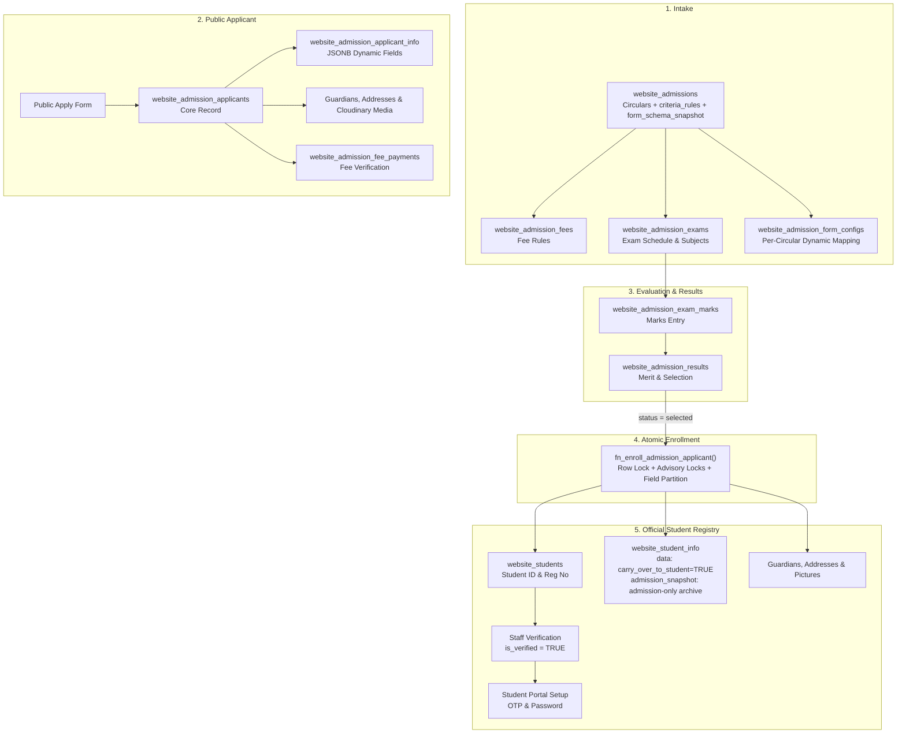

# Brief Architecture Summary: Admission, Applicant & Student Subsystems

## 1. High-Level Lifecycle Flow

---

## 2. Core Tables Summary

| Domain | Table Name | Purpose & Role |
| :--- | :--- | :--- |
| **Admission Intake** | `website_admissions` | Circular settings, deadlines, class targets, selection mode (`exam`, `merit`, `manual`), `criteria_rules` (AST engine), and frozen `form_schema_snapshot`. |
| | `website_admission_form_configs` | Per-circular dynamic form mapping table decoupling circulars from master field catalog. |
| | `website_admission_fees` | Dynamic application fee amounts and rules by circular. |
| | `website_admission_exams` | Exam schedules, roll generation, and admit card configurations. |
| | `website_admission_exam_subjects` | Subject-wise breakdown of marks and pass criteria. |
| | `website_admission_results` | Computed final scores, ranks, and selection status (`selected`, `waiting`, `rejected`). |
| **Applicant Data** | `website_admission_applicants` | Primary applicant record with application number, review status, and enrolled student link. |
| | `website_form_fields` | Master dynamic field catalog defining `target_scope`, `carry_over_to_student`, `is_required_in_admission`, `is_required_in_student`, `is_editable_by_student`. |
| | `website_admission_applicant_info` | Key-value JSONB responses indexed via GIN (`jsonb_path_ops`). |
| | `website_admission_applicant_guardians` | Primary and secondary emergency contact/guardian data. |
| | `website_admission_applicant_addresses` | Present and permanent geographical address records. |
| | `website_admission_applicant_images` | Cloudinary CDN URLs for applicant photographs and signatures. |
| | `website_admission_fee_payments` | Transaction reference, payment gateway logs, and fee clearance status. |
| **Official Student** | `website_students` | Formal academic student record with `student_id`, `registration_no`, `class_id`, `section_id`, `roll_no`, `name`, `email`, `phone`, `number`. |
| | `website_student_info` | Modular profile metadata (`data`), immutable `admission_snapshot` archive, and verification status (`pending_setup`, `submitted`, `verified`). |
| | `website_student_guardians` | Cloned legal guardian records for enrolled students. |
| | `website_student_addresses` | Present and permanent address records for enrolled students. |
| | `website_student_pictures` | Student profile photo references on Cloudinary. |
| | `website_student_signatures` | Student signature media references. |
| | `website_student_invoices` & `website_student_ledgers` | Academic fee billing, invoices, payments, and financial ledger. |
| | `website_student_attendances` | Daily/period academic attendance tracking. |
| | `website_student_promotions` | Academic session promotion history. |

---

## 3. Key Operational Mechanics

### A. Dynamic Form Decoupling & Frozen Schema (`website_form_fields` & `website_admission_form_configs`)
* **Master Field Catalog**: Fields specify lifecycle flags (`carry_over_to_student`, `is_required_in_admission`, `is_required_in_student`, `is_editable_by_student`).
* **Circular Decoupling**: Each circular maps fields via `website_admission_form_configs` and generates an immutable `form_schema_snapshot` on `website_admissions`. Subsequent alterations to master fields do not alter historical circular schemas.

### B. Eligibility Criteria Engine (`criteria_rules` & AST Evaluator)
* Validates applicant eligibility prior to row insertion.
* Supports candidate age bounds (as of target date) and recursive Boolean AST trees (`all` for AND, `any` for OR) supporting comparators (`eq`, `neq`, `gte`, `lte`, `gt`, `lt`, `between`, `in`, `not_in`).
* Rejection halts transaction immediately and returns HTTP `422 Unprocessable Entity` with contextual error messages.

### C. Atomic Enrollment Engine (`fn_enroll_admission_applicant`)
The conversion from candidate to registered student is fully atomic:
1. Obtains a row-level lock on the applicant (`FOR UPDATE`) to prevent concurrent double-enrollment.
2. Acquires transaction-scoped advisory locks for registration number and class roll number.
3. Inserts into `website_students` (`is_active = FALSE`, `is_verified = FALSE`).
4. **Data Partitioning**:
   - `carry_over_to_student = TRUE` fields are extracted into `website_student_info.data`.
   - Admission-only answers and historical exam scores are preserved inside `website_student_info.admission_snapshot`.
5. Clones guardians, addresses, and Cloudinary media links.
6. Sets `enrolled_student_id` and timestamps `enrolled_at` on the applicant.

### D. Verification & Student Onboarding Setup
1. **Verification Safeguard**: Newly enrolled students cannot immediately log in until staff verifies their credentials.
2. **Account Setup**: Student initiates password creation via email OTP (`/api/[domain]/student/setup/send-code` $\rightarrow$ `/api/[domain]/student/setup/verify-code`).
3. **Immutability Protection**: Pre-populated carry-over fields where `is_editable_by_student = FALSE` are protected against client tampering during onboarding setup.

---

## 4. Key API Endpoints Reference

| Layer | Path | Method | Description |
| :--- | :--- | :--- | :--- |
| **Public** | `/api/[domain]/admissions/apply` | `GET` | Return circular details, frozen `form_schema_snapshot`, fee rules, and exam dates. |
| | `/api/[domain]/admissions/apply` | `POST` | Validates criteria AST & dynamic fields in transaction; registers applicant & invoice. |
| | `/api/[domain]/admissions/upload` | `POST` | Upload photo/signature to Cloudinary CDN. |
| | `/api/[domain]/admissions/pay` | `POST` | Submit payment verification / gateway callback. |
| | `/api/[domain]/admissions/admit-card` | `GET` | Retrieve and render candidate admit card. |
| | `/api/[domain]/admissions/results` | `GET` | Public merit list and circular result lookup. |
| **Staff Panel** | `/api/[domain]/staff/panel/admissions` | `GET`, `POST`, `PUT` | Create/update circulars, set `criteria_rules`, map form configs, and freeze snapshot. |
| | `/api/[domain]/staff/panel/admissions/applicants` | `GET`, `PATCH` | Scrutinize applicant submissions and filter by desk status. |
| | `/api/[domain]/staff/panel/admissions/exam-marks` | `POST` | Enter and update candidate exam scores. |
| | `/api/[domain]/staff/panel/admissions/results/publish`| `POST` | Compute rankings and publish results. |
| | `/api/[domain]/staff/panel/admissions/enrollment` | `POST` | Executes `fn_enroll_admission_applicant` with row locking and data partitioning. |
| | `/api/[domain]/staff/panel/students` | `GET`, `POST` | Student registry querying and direct student creation. |
| | `/api/[domain]/staff/panel/students/verify` | `POST` | Verify student profiles to enable portal access. |
| **Student** | `/api/[domain]/student/setup/send-code` | `POST` | Send 6-digit verification code to student email. |
| | `/api/[domain]/student/setup/verify-code` | `GET` | Fetch student setup context, carry-over fields, and active student form fields. |
| | `/api/[domain]/student/setup/verify-code` | `POST` | Verify OTP code or finalize onboarding (protecting non-editable carry-overs). |
| | `/api/[domain]/student/login` | `POST` | Authenticate student and issue JWT cookie. |
| | `/api/[domain]/student/me` | `GET` | Fetch authenticated student profile, enrollments, and ledger. |
