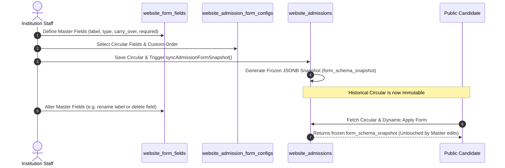
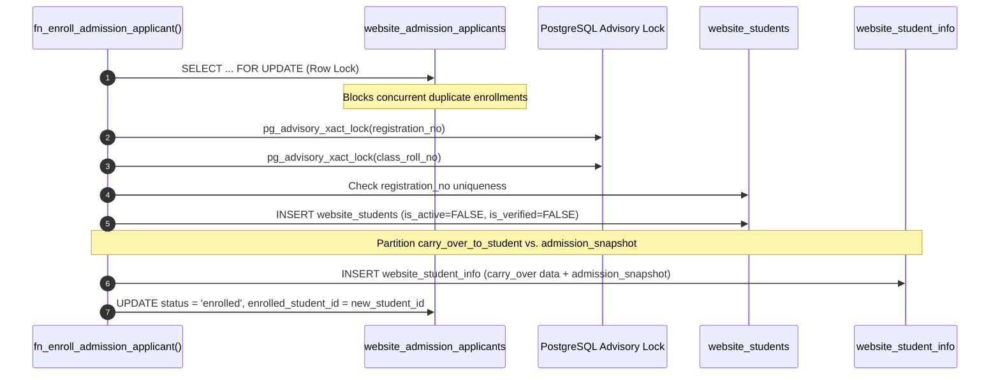
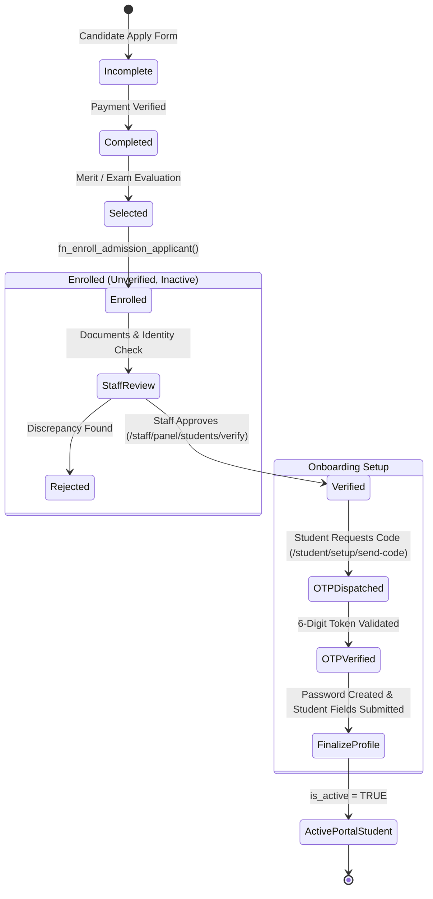

# Comprehensive System Architecture Analysis: Admission, Applicant & Student Subsystems

**Repository:** `d:\code\sii`  
**Target Environment:** Next.js (App Router, JavaScript/JSX), PostgreSQL (`pg`), Supabase Multi-Tenant Engine  
**Last Updated:** Current System Architecture & Implementation

---

## 1. Executive Architectural Overview & High-Level Lifecycle Flow

The Admission, Applicant, and Student Subsystems form the foundational academic backbone of the multi-tenant institution platform. The architecture manages an institutional candidate's lifecycle from initial marketing discovery and public circular application, through exam and merit processing, atomic enrollment into the official institutional registry, and into active academic participation (billing, gradebooks, attendance, and identity credentials).

### Subsystem Boundaries & Separation of Concerns

```mermaid
flowchart TD
    subgraph 1. Intake & Form Architecture
        ADM[website_admissions<br/>Circulars + criteria_rules + form_schema_snapshot]
        AFC[website_admission_form_configs<br/>Per-Circular Dynamic Mapping]
        WFF[website_form_fields<br/>Master Dynamic Field Catalog]
        FEES[website_admission_fees<br/>Application Fee Rules]
        EXM[website_admission_exams<br/>Schedule, Venue & Admit Configs]
        EXS[website_admission_exam_subjects<br/>Subject Marks Breakdown]
        
        WFF --> AFC
        AFC --> ADM
        ADM --> FEES
        ADM --> EXM
        EXM --> EXS
    end

    subgraph 2. Public Applicant Experience
        APP_FORM[Public Application Portal<br/>Next.js Dynamic Form]
        AST_VAL[Recursive AST Criteria Engine<br/>Age Bounds + Nested AND/OR]
        APP[website_admission_applicants<br/>Core Candidate Record]
        APPI[website_admission_applicant_info<br/>JSONB Dynamic Responses]
        APPG[website_admission_applicant_guardians<br/>JSONB Guardians]
        APPA[website_admission_applicant_addresses<br/>JSONB Addresses]
        APPM[website_admission_applicant_images<br/>Cloudinary CDN URLs]
        PAY[website_admission_fee_payments<br/>Gateway Verification]
        
        ADM --> APP_FORM
        APP_FORM --> AST_VAL
        AST_VAL -->|Passed| APP
        APP --> APPI
        APP --> APPG
        APP --> APPA
        APP --> APPM
        APP --> PAY
    end

    subgraph 3. Assessment, Merit & Selection
        MARKS[website_admission_exam_marks<br/>Subject Scores Entry]
        RESULTS[website_admission_results<br/>Merit Ranks & Selection Status]
        
        EXS --> MARKS
        APP --> MARKS
        MARKS --> RESULTS
        RESULTS -->|status = selected| READY_ENROLL[Candidate Ready For Enrollment]
    end

    subgraph 4. Atomic Enrollment Engine
        SP_CALL["fn_enroll_admission_applicant()<br/>Row Lock + Advisory Locks"]
        PARTITION[Dynamic Data Partitioning<br/>carry_over_to_student = TRUE]
        SNAPSHOT[Immutable Admission Archive<br/>admission_snapshot JSONB]
        
        READY_ENROLL --> SP_CALL
        SP_CALL --> PARTITION
        SP_CALL --> SNAPSHOT
    end

    subgraph 5. Official Student Registry
        STU[website_students<br/>Official Reg No & Student ID]
        STUI[website_student_info<br/>data JSONB + admission_snapshot]
        STUG[website_student_guardians]
        STUA[website_student_addresses]
        STUP[website_student_pictures]
        STUS[website_student_signatures]
        
        PARTITION --> STUI
        SNAPSHOT --> STUI
        SP_CALL --> STU
        SP_CALL --> STUG
        SP_CALL --> STUA
        SP_CALL --> STUP
        SP_CALL --> STUS
    end

    subgraph 6. Staff Verification & Student Onboarding
        VERIF[Staff Verification<br/>is_verified = TRUE]
        OTP[Self-Setup Onboarding<br/>Central Brevo Mailer / SMS OTP]
        ACTIVE[Active Academic Student<br/>is_active = TRUE]
        
        STU --> VERIF
        VERIF --> OTP
        OTP --> ACTIVE
    end

    subgraph 7. Active Academic Lifecycle
        INV[website_student_invoices & ledgers<br/>Fee Billing & Accounts]
        ATT[website_student_attendances<br/>Daily & Period Tracking]
        DOCS[website_student_ids, tcs, certs<br/>Academic Credentials]
        PROM[website_student_promotions<br/>Annual Session Upgrades]
        
        ACTIVE --> INV
        ACTIVE --> ATT
        ACTIVE --> DOCS
        ACTIVE --> PROM
    end
```

---

## 2. Exhaustive Database Schema Matrix & Table Topology

The system comprises 35 interconnected tables defined in [`psql/website_tables.psql`](file:///d:/code/sii/psql/website_tables.psql) and [`psql/schema.psql`](file:///d:/code/sii/psql/schema.psql), organized into seven distinct functional clusters:

### Cluster A: Admission Intake & Configuration (8 Tables)

#### 1. `website_admissions` (Intake Circulars & Campaigns)
Represents a circular published by an institution for admission into an academic class or session.
- **Columns**:
  - `id` (BIGSERIAL PRIMARY KEY)
  - `website_id` (BIGINT NOT NULL REFERENCES `websites(id)` ON DELETE CASCADE)
  - `department_id` (BIGINT REFERENCES `website_departments(id)` ON DELETE SET NULL)
  - `session_id` (BIGINT REFERENCES `website_sessions(id)` ON DELETE SET NULL)
  - `class_id` (BIGINT REFERENCES `website_classes(id)` ON DELETE SET NULL)
  - `title` (VARCHAR(255) NOT NULL): Circular headline (e.g., "Class XI Science Admission 2026-27").
  - `description` (TEXT): Full circular brochure and requirements.
  - `start_date` (DATE NOT NULL) & `end_date` (DATE NOT NULL): Application acceptance window.
  - `exam_date` (DATE) & `result_date` (DATE): Intake timeline milestones.
  - `min_age` (INT) & `max_age` (INT): Baseline age constraints.
  - `capacity` (INT DEFAULT 100): Maximum student seats allocated for this circular.
  - `status` (VARCHAR(50) DEFAULT 'open'): Check constraint `('open', 'closed', 'upcoming', 'archived')`.
  - `is_published` (BOOLEAN DEFAULT TRUE): Visibility on public portal.
  - `selection_method` (VARCHAR(50) DEFAULT 'manual'): Check constraint `('exam', 'merit', 'manual')`.
  - `is_result_published` (BOOLEAN DEFAULT FALSE) & `result_published_at` (TIMESTAMPTZ).
  - `form_schema_snapshot` (JSONB NOT NULL DEFAULT `'[]'::jsonb`): Frozen array of dynamic form fields captured upon circular creation/update.
  - `criteria_rules` (JSONB NOT NULL DEFAULT `'{"age":{"enabled":false},"rules":{"all":[]}}'::jsonb`): Recursive eligibility AST.
  - `created_by_staff_id` (BIGINT REFERENCES `website_staffs(id)` ON DELETE SET NULL).
  - `created_at` & `updated_at` (TIMESTAMPTZ DEFAULT CURRENT_TIMESTAMP).
- **Indexes**: `idx_ws_adm_web(website_id)`, `idx_ws_adm_class(website_id, class_id)`, `idx_ws_adm_status(website_id, status)`.

#### 2. `website_admission_form_configs` (Per-Circular Dynamic Mapping)
Decouples individual circulars from the institution's master catalog (`website_form_fields`), enabling circular-specific ordering, field selection, and required overrides.
- **Columns**:
  - `id` (BIGSERIAL PRIMARY KEY)
  - `website_id` (BIGINT NOT NULL REFERENCES `websites(id)` ON DELETE CASCADE)
  - `admission_id` (BIGINT NOT NULL REFERENCES `website_admissions(id)` ON DELETE CASCADE)
  - `form_field_id` (BIGINT NOT NULL REFERENCES `website_form_fields(id)` ON DELETE CASCADE)
  - `is_required` (BOOLEAN NOT NULL DEFAULT TRUE)
  - `sort_order` (INT NOT NULL DEFAULT 0)
  - `created_at` (TIMESTAMPTZ DEFAULT NOW())
  - `UNIQUE (admission_id, form_field_id)`
- **Indexes**: `idx_adm_form_configs_lookup(website_id, admission_id, sort_order)`.

#### 3. `website_admission_exams` (Intake Exam Settings)
Contains administrative and proctoring settings for circulars using `selection_method = 'exam'`.
- **Columns**: `id`, `website_id`, `admission_id` (UNIQUE), `exam_date` (TIMESTAMPTZ), `admit_publish_date` (TIMESTAMPTZ), `venue` (VARCHAR(255)), `instructions` (TEXT), `created_at`, `updated_at`.
- **Indexes**: `idx_ws_adm_exams_web(website_id)`, `idx_ws_adm_exams_adm(admission_id)`.

#### 4. `website_admission_exam_subjects` (Intake Examination Subjects)
Defines individual test subjects, time limits, and maximum marks.
- **Columns**: `id`, `website_id`, `admission_id`, `admission_exam_id`, `title` (VARCHAR(150)), `mark` (NUMERIC(6,2) DEFAULT 100.00), `time` (VARCHAR(50) DEFAULT '1 hour'), `created_at`, `updated_at`.
- **Indexes**: `idx_ws_adm_exam_sub_adm(admission_id)`.

#### 5. `website_admission_fees` (Application Fee Structure)
Configures form pricing and late submission fees per circular.
- **Columns**: `id`, `website_id`, `admission_id`, `fee_title` (VARCHAR(255)), `amount` (NUMERIC(10,2) DEFAULT 0.00), `currency` (VARCHAR(10) DEFAULT 'BDT'), `late_fee` (NUMERIC(10,2) DEFAULT 0.00), `status` ('active', 'inactive'), `created_at`, `updated_at`.
- **Indexes**: `idx_ws_adm_fees_web(website_id)`, `idx_ws_adm_fees_adm(admission_id)`.

#### 6. `website_admission_fee_payments` (Form Purchase Invoices & Gateway Logs)
Records application fee transactions processed via SSLCommerz, Shurjopay, bKash, or offline counter receipts.
- **Columns**: `id`, `website_id`, `applicant_id`, `admission_id`, `gateway_account_id`, `gateway_code` (VARCHAR(50)), `amount` (NUMERIC(10,2)), `currency`, `transaction_id`, `payment_status` ('pending', 'paid', 'failed'), `paid_date`, `invoice_no`, `notes`, `created_at`, `updated_at`.
- **Indexes**: `idx_ws_adm_pay_web`, `idx_ws_adm_pay_app`, `idx_ws_adm_pay_stat`.

#### 7. `website_admission_exam_marks` (Candidate Subject Test Scores)
Captures examiner scoring for each candidate per subject.
- **Columns**: `id`, `website_id`, `admission_id`, `subject_id`, `applicant_id`, `marks_obtained` (NUMERIC(6,2)), `remarks`, `created_at`, `updated_at`.
- **Constraints**: `UNIQUE (admission_id, subject_id, applicant_id)`.
- **Indexes**: `idx_ws_adm_marks_adm`, `idx_ws_adm_marks_app`.

#### 8. `website_admission_results` (Published Selection & Merit Lists)
Stores final computed ranks, overall test scores, and selection outcomes.
- **Columns**: `id`, `website_id`, `admission_id`, `applicant_id`, `roll_no`, `applicant_name`, `merit_position` (INT), `score` (NUMERIC(6,2)), `selection_status` ('selected', 'waiting', 'rejected'), `remarks`, `is_published` (BOOLEAN), `published_at`, `published_by_staff_id`, `created_at`, `updated_at`.
- **Constraints**: `UNIQUE (admission_id, applicant_id)`.
- **Indexes**: `idx_ws_adm_res_web`, `idx_ws_adm_res_adm`, `idx_ws_adm_res_pub`.

---

### Cluster B: Candidate Application Records (5 Tables)

#### 9. `website_admission_applicants` (Core Candidate Record)
The master candidate submission record.
- **Columns**:
  - `id` (BIGSERIAL PRIMARY KEY)
  - `website_id` (BIGINT NOT NULL REFERENCES `websites(id)` ON DELETE CASCADE)
  - `admission_id` (BIGINT NOT NULL REFERENCES `website_admissions(id)` ON DELETE CASCADE)
  - `application_no` (VARCHAR(100) NOT NULL): Unique tracking identifier (e.g., `APP-2026-94812`).
  - `exam_roll` (VARCHAR(50)): Assigned examination roll number for admit cards.
  - `applicant_name` (VARCHAR(255) NOT NULL)
  - `email` (VARCHAR(255) NOT NULL)
  - `phone` (VARCHAR(50) NOT NULL)
  - `gender` (VARCHAR(20) DEFAULT 'Male' CHECK `('Male', 'Female', 'Other')`)
  - `date_of_birth` (DATE)
  - `status` (VARCHAR(50) DEFAULT 'incomplete'): State machine `('pending', 'incomplete', 'unpaid', 'paid', 'completed', 'selected', 'rejected', 'enrolled', 'accepted')`.
  - `selection_notes` (TEXT)
  - `score` (NUMERIC(6,2) DEFAULT 0.00) & `merit_position` (INT)
  - `is_admit_card_issued` (BOOLEAN DEFAULT FALSE) & `admit_card_issued_at` (TIMESTAMPTZ)
  - `selected_at` (TIMESTAMPTZ) & `selected_by_staff_id` (BIGINT)
  - `enrolled_at` (TIMESTAMPTZ) & `enrolled_student_id` (BIGINT REFERENCES `website_students(id)` ON DELETE SET NULL)
  - `UNIQUE (website_id, application_no)` & `UNIQUE (website_id, email)`
- **Indexes**: `idx_ws_adm_app_web`, `idx_ws_adm_app_adm`, `idx_ws_adm_app_stat`, `idx_website_admission_applicants_unique_lower_email`, `idx_ws_adm_app_exam_roll`.

#### 10. `website_admission_applicant_info` (Modular Candidate Form Payload)
Stores tenant-specific dynamic responses in JSONB.
- **Columns**: `id`, `website_id`, `applicant_id` (UNIQUE), `data` (JSONB NOT NULL DEFAULT `'{}'::jsonb`), `created_at`, `updated_at`.
- **Indexes**: `idx_applicant_info_jsonb_gin ON website_admission_applicant_info USING GIN (data jsonb_path_ops)`.

#### 11. `website_admission_applicant_guardians` (Modular Candidate Guardians)
Stores primary father/mother/legal guardian contacts in JSONB.
- **Columns**: `id`, `website_id`, `applicant_id` (UNIQUE), `data` (JSONB NOT NULL DEFAULT `'{}'::jsonb`), `created_at`, `updated_at`.

#### 12. `website_admission_applicant_addresses` (Modular Candidate Addresses)
Stores present and permanent addresses in JSONB format.
- **Columns**: `id`, `website_id`, `applicant_id` (UNIQUE), `data` (JSONB NOT NULL DEFAULT `'{}'::jsonb`), `created_at`, `updated_at`.

#### 13. `website_admission_applicant_images` (Cloudinary Asset Registry)
Stores CDN URLs and public IDs for candidate photo and signature assets.
- **Columns**: `id`, `website_id`, `applicant_id` (UNIQUE), `photo_url` (TEXT NOT NULL), `photo_public_id` (VARCHAR(255)), `signature_url` (TEXT NOT NULL), `signature_public_id` (VARCHAR(255)), `uploaded_at`, `created_at`, `updated_at`.

---

### Cluster C: Master Form Catalog & Field Lifecycle Engine (2 Tables / Views)

#### 14. `website_form_fields` (Master Dynamic Field Catalog)
The centralized field repository defining schema, UI presentation, validation rules, and cross-subsystem carry-over behaviors.
- **Columns**:
  - `id` (BIGSERIAL PRIMARY KEY)
  - `website_id` (BIGINT NOT NULL REFERENCES `websites(id)` ON DELETE CASCADE)
  - `target_scope` (VARCHAR(50) DEFAULT 'info' CHECK `('info', 'guardians', 'addresses', 'academic', 'custom')`)
  - `field_key` (VARCHAR(100) NOT NULL): JSONB key (e.g. `blood_group`, `previous_school_gpa`).
  - `label` (VARCHAR(150) NOT NULL) & `label_translations` (JSONB DEFAULT `'{}'::jsonb`)
  - `field_type` (VARCHAR(50) CHECK `('text', 'number', 'select', 'multiselect', 'date', 'file', 'textarea', 'boolean')`)
  - `options` (JSONB DEFAULT `'[]'::jsonb`): Select options list.
  - `is_required` (BOOLEAN DEFAULT FALSE): Global fallback requirement.
  - `is_required_in_admission` (BOOLEAN DEFAULT FALSE): Mandatory during public candidate apply.
  - `is_required_in_student` (BOOLEAN DEFAULT FALSE): Mandatory during student onboarding setup.
  - `carry_over_to_student` (BOOLEAN DEFAULT TRUE): Controls whether `fn_enroll_admission_applicant()` extracts this field into `website_student_info.data` or leaves it strictly in `admission_snapshot`.
  - `is_editable_by_student` (BOOLEAN DEFAULT TRUE): Protects institutional fields against student editing during portal setup.
  - `is_unique` (BOOLEAN DEFAULT FALSE): Enforces global tenant uniqueness on the JSONB key.
  - `validation_regex` (VARCHAR(255))
  - `placeholder` (VARCHAR(150)) & `help_text` (VARCHAR(255))
  - `section` (VARCHAR(100) DEFAULT 'personal' CHECK `('personal', 'academic', 'guardian', 'address', 'general', 'medical', 'other')`)
  - `is_visible_in_admission` (BOOLEAN DEFAULT TRUE)
  - `is_visible_in_student` (BOOLEAN DEFAULT TRUE)
  - `is_visible_in_id_card` (BOOLEAN DEFAULT FALSE)
  - `sort_order` (INT DEFAULT 0)
  - `is_active` (BOOLEAN DEFAULT TRUE)
  - `UNIQUE (website_id, target_scope, field_key)`
- **Indexes**: `idx_form_fields_tenant_lifecycle(website_id, target_scope, is_visible_in_admission, is_visible_in_student)`, `idx_website_form_fields_scope`.

#### 15. `website_admission_form_fields` (Compatibility View)
View defined as `SELECT * FROM website_form_fields` to preserve backward compatibility for legacy callers.

---

### Cluster D: Official Student Registry & Identity (7 Tables)

#### 16. `website_students` (Core Official Academic Identity)
Represents registered students holding enrollment status within the institution.
- **Columns**:
  - `id` (BIGSERIAL PRIMARY KEY)
  - `website_id` (BIGINT NOT NULL REFERENCES `websites(id)` ON DELETE CASCADE)
  - `admission_applicant_id` (BIGINT REFERENCES `website_admission_applicants(id)` ON DELETE SET NULL)
  - `session_id`, `class_id`, `section_id`, `department_id` (Academic Class Placement)
  - `registration_no` (VARCHAR(100) NOT NULL): Formal institutional registration number (e.g. `REG-2026-1004`).
  - `student_unique_id` (VARCHAR(100) NOT NULL): Unique login identifier (e.g. `STU20260401`).
  - `roll_no` (VARCHAR(50)): Class roll number.
  - `name`, `email`, `phone`, `number` (VARCHAR(50) fallback)
  - `gender`, `blood_group`, `date_of_birth`, `religion`
  - `password` (TEXT): Bcrypt salted password hash (populated upon setup).
  - `recovery_token`, `recovery_token_expires`, `two_factor_code`, `two_factor_expires`
  - `verification_token`, `verification_token_expires`: Onboarding setup credentials.
  - `is_active` (BOOLEAN DEFAULT FALSE): Becomes TRUE once the student completes portal password setup.
  - `is_verified` (BOOLEAN DEFAULT FALSE): Becomes TRUE once staff verifies credentials.
  - `verified_at` (TIMESTAMPTZ) & `verified_by_staff_id` (BIGINT REFERENCES `website_staffs(id)`)
  - `last_login` (TIMESTAMPTZ)
  - `created_at` & `updated_at` (TIMESTAMPTZ DEFAULT CURRENT_TIMESTAMP)
  - `UNIQUE (website_id, registration_no)` & `UNIQUE (website_id, student_unique_id)`
- **Indexes**: `idx_website_students_unique_lower_email`, `idx_website_students_unique_lower_reg_no`, `idx_ws_students_email`, `idx_website_students_admission_app`.

#### 17. `website_student_info` (Modular Student Profile & Admission Snapshot)
Stores modular student attributes, onboarding status, and historical admission snapshots.
- **Columns**:
  - `id` (BIGSERIAL PRIMARY KEY)
  - `website_id` (BIGINT NOT NULL REFERENCES `websites(id)` ON DELETE CASCADE)
  - `student_id` (BIGINT NOT NULL UNIQUE REFERENCES `website_students(id)` ON DELETE CASCADE)
  - `data` (JSONB NOT NULL DEFAULT `'{}'::jsonb`): Contains all student-scope fields and carried-over fields where `carry_over_to_student = TRUE`.
  - `admission_snapshot` (JSONB NOT NULL DEFAULT `'{}'::jsonb`): Immutable archival JSON capturing original candidate application answers, scores, exam rolls, and reviewer staff ID.
  - `verification_status` (VARCHAR(50) DEFAULT 'pending_setup' CHECK `('pending_setup', 'submitted', 'verified', 'rejected')`)
  - `is_registered` (BOOLEAN DEFAULT FALSE)
  - `verification_notes` (TEXT) & `rejection_reason` (TEXT)
  - `created_at` & `updated_at` (TIMESTAMPTZ)
- **Indexes**: `idx_student_info_jsonb_gin ON website_student_info USING GIN (data jsonb_path_ops)`.

#### 18. `website_student_guardians` & 19. `website_student_addresses`
Cloned official guardian and address stores populated during enrollment.
- **Columns**: `id`, `website_id`, `student_id` (UNIQUE), `data` (JSONB NOT NULL DEFAULT `'{}'::jsonb`), `created_at`, `updated_at`.

#### 20. `website_student_pictures` & 21. `website_student_signatures`
Official photograph and signature assets cloned from Cloudinary intake references.
- **Columns**: `id`, `website_id`, `student_id`, `image_url` / `signature_url`, `image_id` / `signature_id`, `is_primary`, `created_at`, `updated_at`.

#### 22. `website_student_login_sessions`
JWT bearer session tracking for student portal logins.
- **Columns**: `id`, `website_id`, `student_id`, `session_token` (VARCHAR(255) NOT NULL UNIQUE), `ip_address`, `user_agent`, `is_active` (BOOLEAN), `expires_at` (TIMESTAMPTZ).

---

### Cluster E: Student Financial & Billing Subsystem (5 Tables)

#### 23. `website_student_invoices` (Monthly & Term Billing Statements)
Itemized billing statements for tuition, examination fees, lab fees, and campus services.
- **Columns**: `id`, `website_id`, `student_id`, `invoice_no` (VARCHAR(100) UNIQUE), `session_id`, `month`, `subtotal`, `waiver_total`, `fine_total`, `total_amount`, `paid_amount`, `due_amount`, `due_date`, `status` ('unpaid', 'partially_paid', 'paid', 'overdue', 'cancelled'), `created_at`, `updated_at`.

#### 24. `website_student_invoice_items` (Itemized Bill Breakdown)
- **Columns**: `id`, `website_id`, `invoice_id`, `head_id` (REFERENCES `website_fee_heads`), `title`, `amount`, `waiver_amount`, `fine_amount`, `net_amount`, `created_at`.

#### 25. `website_student_ledgers` (Double-Entry Financial Audit Trail)
Maintains an immutable running balance for each student account.
- **Columns**: `id`, `website_id`, `student_id`, `entry_type` ('debit', 'credit'), `account_category`, `amount`, `balance_after`, `reference_id`, `description`, `created_at`.

#### 26. `website_student_wallets` (Prepaid Advance Balances)
- **Columns**: `id`, `website_id`, `student_id` (UNIQUE), `balance` (NUMERIC(12,2) DEFAULT 0.00), `last_deposited_at`, `created_at`, `updated_at`.

#### 27. `website_refund_requests` (Excess Payment & Security Deposit Refunds)
- **Columns**: `id`, `website_id`, `student_id`, `amount`, `reason`, `status` ('pending', 'approved', 'rejected', 'disbursed'), `approved_by`, `transaction_reference`, `created_at`.

---

### Cluster F: Academic Progression, Credentials & Exit (8 Tables)

#### 28. `website_student_attendances` (Daily & Subject Attendance)
- **Columns**: `id`, `website_id`, `student_id`, `class_id`, `section_id`, `attendance_date`, `status` ('present', 'absent', 'late', 'half_day', 'leave'), `remarks`, `marked_by_teacher_id`, `created_at`.

#### 29. `website_student_exam_marks` & 30. `website_student_exam_results`
Stores ongoing term exam marks, full marks, pass marks, grades, grade points (GPA), merit ranks, and official academic report cards.

#### 31. `website_student_promotions` (Annual Session Progression)
Preserves historical session and roll progressions when students advance classes.
- **Columns**: `id`, `website_id`, `student_id`, `from_session_id`, `to_session_id`, `from_class_id`, `to_class_id`, `from_roll_no`, `to_roll_no`, `promotion_type` ('regular', 'conditional', 'retained', 'double_promoted'), `promoted_at`.

#### 32. `website_student_ids` (Issued Physical / Digital ID Cards)
- **Columns**: `id`, `website_id`, `student_id`, `card_number` (UNIQUE), `template_id`, `session_id`, `class_id`, `section_id`, `issue_date`, `expiry_date`, `barcode_data`, `card_status` ('active', 'expired', 'lost', 'revoked', 'reissued'), `issued_by_staff_id`, `custom_data`.

#### 33. `website_student_tcs` (Transfer Certificates) & 34. `website_student_certificates` (Awards & Transcripts)
Issued official academic leaving and graduation documents.

#### 35. `website_student_exits` (Graduation & Rustication Records)
Tracks student departure reasons (`'graduated', 'transferred', 'dropped_out', 'rusticated'`), departure dates, and destination institutions.

---

### Cluster G: Quota & Central Notification Integration (2 Tables)

#### 36. `packages` (Platform SaaS Tiers)
Includes resource limits for multi-tenant institutions:
- `monthly_mail` (INT NOT NULL DEFAULT 1000): Allowed central Brevo transactional emails per month.
- `monthly_sms` (INT NOT NULL DEFAULT 200): Allowed central SMS gateway dispatches per month.

#### 37. `website_monthly_usages` (Email & SMS Quota Tracking)
Tracks consumption per tenant per calendar month (`year_month` e.g., `'2026-11'`).
- **Columns**: `id`, `website_id`, `year_month`, `mail_count`, `sms_count`, `created_at`, `updated_at`, `UNIQUE (website_id, year_month)`.

---

## 3. Dynamic Form Separation & Schema Snapshot Engine

A central architectural requirement of the redesign is eliminating coupling between historical admission intake circulars and ongoing master field catalog edits.



### The Three Field Classifications
1. **Admission-Only Fields (`carry_over_to_student = FALSE`)**:
   - Examples: `previous_school_gpa`, `ssc_registration_roll`, `quota_certificate_attachment`, `admission_test_venue_choice`.
   - Behavior: Validated and stored in `website_admission_applicant_info.data`. During enrollment, `fn_enroll_admission_applicant()` preserves them inside `website_student_info.admission_snapshot` without adding them to active student profile data.
2. **Carry-Over Fields (`carry_over_to_student = TRUE`)**:
   - Examples: `blood_group`, `birth_registration_number`, `emergency_contact_phone`, `father_occupation`.
   - Behavior: Copied directly into `website_student_info.data` during enrollment.
3. **Student-Only Onboarding Fields (`is_visible_in_admission = FALSE, is_visible_in_student = TRUE`)**:
   - Examples: `hostel_room_preference`, `transport_pickup_stop`, `dietary_preference`, `student_portal_password`.
   - Behavior: Concealed during admission intake; rendered only during post-enrollment onboarding setup.

### Snapshot Synchronization Implementation
Implemented in [`src/lib/form-criteria-engine.js`](file:///d:/code/sii/src/lib/form-criteria-engine.js) via `syncAdmissionFormSnapshot()`:
```sql
WITH resolved_fields AS (
  SELECT
    ff.id AS form_field_id,
    ff.target_scope,
    ff.field_key,
    ff.label,
    ff.field_type,
    ff.options,
    ff.validation_regex,
    ff.is_unique,
    ff.carry_over_to_student,
    COALESCE(afc.is_required, ff.is_required_in_admission, ff.is_required) AS is_required,
    COALESCE(afc.sort_order, 0) AS sort_order
  FROM website_form_fields ff
  LEFT JOIN website_admission_form_configs afc
    ON afc.form_field_id = ff.id AND afc.admission_id = $2
  WHERE ff.website_id = $1
    AND ff.is_visible_in_admission = TRUE
    AND (
      NOT EXISTS (SELECT 1 FROM website_admission_form_configs WHERE admission_id = $2)
      OR afc.id IS NOT NULL
    )
  ORDER BY COALESCE(afc.sort_order, 0) ASC, ff.id ASC
)
UPDATE website_admissions
SET form_schema_snapshot = COALESCE(
  (SELECT jsonb_agg(row_to_json(resolved_fields)) FROM resolved_fields),
  '[]'::jsonb
)
WHERE id = $2 AND website_id = $1
RETURNING form_schema_snapshot;
```

---

## 4. Recursive Eligibility Criteria AST Engine

The admission engine evaluates criteria stored in `website_admissions.criteria_rules` to reject ineligible candidates before writing records:

```json
{
  "age": {
    "enabled": true,
    "min_years": 14.5,
    "max_years": 18.0,
    "as_of_date": "2026-07-01"
  },
  "rules": {
    "all": [
      {
        "field": "info.ssc_gpa",
        "op": "gte",
        "value": 4.5,
        "msg": "Minimum SSC GPA of 4.50 is required."
      },
      {
        "any": [
          {
            "field": "info.quota_category",
            "op": "eq",
            "value": "freedom_fighter",
            "msg": "Freedom Fighter Quota Applied"
          },
          {
            "field": "info.math_higher_mark",
            "op": "gte",
            "value": 80,
            "msg": "Higher Math score must be at least 80."
          }
        ],
        "msg": "Must either possess Freedom Fighter quota or score at least 80 in Higher Math."
      }
    ]
  }
}
```

### Supported Operators
- `eq`: Exact case-insensitive string equality.
- `neq`: Inverse equality.
- `gte`, `gt`: Numerical greater-than-or-equal / strictly greater.
- `lte`, `lt`: Numerical less-than-or-equal / strictly less.
- `between`: Numerical array range `[min, max]`.
- `in`, `not_in`: Set membership.

### Evaluation Workflow in `validateSubmissionPayload`
1. **Age Bounding**: Compares candidate's `date_of_birth` against `as_of_date` (or `CURRENT_DATE`), computing exact age in decimal years.
2. **Recursive AST Traversal**: Evaluates boolean `all` (AND) and `any` (OR) trees.
3. **Transactional JSONB Uniqueness**: For fields marked `is_unique = TRUE`, acquires an advisory lock (`pg_advisory_xact_lock`) on the composite key and confirms no existing candidate in `website_admission_applicant_info` shares the value.
4. **Rejection Safeguard**: If any rule fails, halts processing and returns HTTP 422 with an array of descriptive error strings.

---

## 5. Atomic Enrollment Engine (`fn_enroll_admission_applicant`)

The stored procedure [`fn_enroll_admission_applicant`](file:///d:/code/sii/psql/website_tables.psql#L4513-L4697) converts selected candidates into registered students atomically:

```sql
CREATE OR REPLACE FUNCTION fn_enroll_admission_applicant(
    p_website_id BIGINT,
    p_applicant_id BIGINT,
    p_session_id BIGINT,
    p_class_id BIGINT,
    p_section_id BIGINT,
    p_department_id BIGINT,
    p_roll_no VARCHAR(50),
    p_registration_no VARCHAR(100),
    p_student_unique_id VARCHAR(100),
    p_setup_token VARCHAR(255),
    p_setup_token_expires TIMESTAMPTZ,
    p_staff_id BIGINT
) RETURNS BIGINT
```

### Concurrency Protection & Row Locks


### Step-by-Step Procedure Execution
1. **Row-Level Lock (`FOR UPDATE`)**:
   Locks the applicant row in `website_admission_applicants`. Verifies applicant exists, belongs to `p_website_id`, has status `'selected'` or `'accepted'`, and has not already been enrolled.
2. **Transaction-Scoped Advisory Locks**:
   - `pg_advisory_xact_lock(hashtext(p_website_id::text || ':reg:' || p_registration_no))`
   - `pg_advisory_xact_lock(hashtext(p_website_id::text || ':roll:' || ... || ':' || p_roll_no))`
   Guarantees zero race conditions on student registration numbers or class rolls under concurrent staff operations.
3. **Core Student Record Insertion**:
   Inserts into `website_students` with:
   - `is_active = FALSE` (requires student setup verification)
   - `is_verified = FALSE` (requires staff profile audit)
   - Setup token and expiration timestamp.
4. **Data Partitioning**:
   - Inspects `website_form_fields`: extracts key-value pairs from `website_admission_applicant_info.data` where `carry_over_to_student = TRUE` into `v_carry_over_info`.
   - Packages candidate responses, original application number, merit score, exam roll, and enrolling staff ID into `v_admission_snapshot`.
   - Inserts both payloads into `website_student_info`.
5. **Entity Cascaded Cloning**:
   - Clones guardians from `website_admission_applicant_guardians` into `website_student_guardians`.
   - Clones addresses from `website_admission_applicant_addresses` into `website_student_addresses`.
   - Clones photo and signature CDN references into `website_student_pictures` and `website_student_signatures`.
6. **State Finalization**:
   Marks applicant status as `'enrolled'`, records `enrolled_student_id`, and returns the newly generated `student_id`.

---

## 6. Student Onboarding, Security & Verification Workflow



### Security Safeguards
1. **Login Prevention Prior to Setup**: `website_students.is_active` remains `FALSE` until password creation succeeds.
2. **Tamper Protection for Non-Editable Fields**: During onboarding setup (`/api/[domain]/student/setup/verify-code`), the server checks `website_form_fields.is_editable_by_student`. If an existing carry-over field has `is_editable_by_student = FALSE`, incoming client overrides are discarded.
3. **Central Mailer & SMS Dispatch with Usage Quotas**:
   - Verification codes are dispatched via central platform Brevo and SMS services ([`websiteBrevo.js`](file:///d:/code/sii/src/lib/database/websiteBrevo.js) and [`smsSender.js`](file:///d:/code/sii/src/lib/database/smsSender.js)).
   - Every email and SMS increments `website_monthly_usages` atomically.
   - If a tenant reaches their package quota (`monthly_mail` or `monthly_sms`), dispatches are throttled.

---

## 7. Complete API Reference Matrix

### Public Candidate Intake Endpoints

| Method | Route Path | Description & Architectural Role |
| :--- | :--- | :--- |
| `GET` | `/api/[domain]/admissions/apply` | Fetches active circular metadata, frozen `form_schema_snapshot`, fee amounts, and schedules. |
| `POST` | `/api/[domain]/admissions/apply` | Validates criteria AST, checks JSONB uniqueness, inserts candidate record, info, guardians, and fees. |
| `POST` | `/api/[domain]/admissions/upload` | Uploads applicant photo and signature assets to Cloudinary CDN; returns URLs and public IDs. |
| `POST` | `/api/[domain]/admissions/send-otp` | Sends email OTP to verify candidate email prior to form submission. |
| `POST` | `/api/[domain]/admissions/verify-otp` | Validates candidate email verification code. |
| `POST` | `/api/[domain]/admissions/pay` | Processes application fee payment callback and transitions candidate status to `paid`/`completed`. |
| `GET` | `/api/[domain]/admissions/admit-card` | Generates candidate admit card with exam venue, roll number, and instructions. |
| `GET` | `/api/[domain]/admissions/results` | Public circular results and merit list lookup. |
| `GET` | `/api/[domain]/admissions/lookup` | Tracking endpoint for candidates to check application status using tracking number. |
| `GET` | `/api/[domain]/admissions/fields` | Public endpoint fetching admission dynamic form fields. |

### Staff Control Panel Administration Endpoints

| Method | Route Path | Description & Architectural Role |
| :--- | :--- | :--- |
| `GET` | `/api/[domain]/staff/panel/admissions` | Lists all intake circulars with applicant counts and status metrics. |
| `POST` | `/api/[domain]/staff/panel/admissions` | Creates admission circular, configures `criteria_rules`, links form fields, and generates `form_schema_snapshot`. |
| `PUT` | `/api/[domain]/staff/panel/admissions` | Updates circular details, regenerates snapshot, and manages intake status. |
| `GET` | `/api/[domain]/staff/panel/admissions/applicants` | Queries candidate roster with filters (class, circular, desk status, payment status). |
| `GET` | `/api/[domain]/staff/panel/admissions/applicants/export`| Generates CSV / Excel exports of candidate submissions. |
| `POST` | `/api/[domain]/staff/panel/admissions/exam-marks` | Bulk marks entry for candidates sitting for admission tests. |
| `POST` | `/api/[domain]/staff/panel/admissions/exam-marks/process`| Computes totals, merit ranks, and updates applicant scores. |
| `POST` | `/api/[domain]/staff/panel/admissions/results/publish` | Publishes merit list and selection status (`selected`, `waiting`, `rejected`). |
| `POST` | `/api/[domain]/staff/panel/admissions/enrollment` | **Executes `fn_enroll_admission_applicant()`** with row locking, data partitioning, and ID assignment. |
| `GET` | `/api/[domain]/staff/panel/students` | Queries master student registry with class, session, and verification filters. |
| `POST` | `/api/[domain]/staff/panel/students` | Direct manual student registration bypassing admission intake. |
| `POST` | `/api/[domain]/staff/panel/students/verify` | Audits and sets `is_verified = TRUE` on enrolled student records. |
| `POST` | `/api/[domain]/staff/panel/students/bulk` | Bulk student operations (class roll reassignment, bulk status changes). |
| `GET` | `/api/[domain]/staff/panel/students/fields` | Manages student-scope dynamic fields. |
| `GET` | `/api/[domain]/staff/panel/usage` | Displays current monthly email and SMS consumption against package quotas. |

### Authenticated Student Portal Endpoints

| Method | Route Path | Description & Architectural Role |
| :--- | :--- | :--- |
| `POST` | `/api/[domain]/student/setup/send-code` | Dispatches 6-digit verification code to student email for initial password setup. |
| `GET` | `/api/[domain]/student/setup/verify-code` | Retrieves student profile context, carried-over fields, and active student form fields. |
| `POST` | `/api/[domain]/student/setup/verify-code` | Validates code, saves new password, stores student onboarding fields, and sets `is_active = TRUE`. |
| `POST` | `/api/[domain]/student/login` | Authenticates student using registration number/email and password; sets HTTP-only cookie. |
| `POST` | `/api/[domain]/student/logout` | Revokes student session token. |
| `GET` | `/api/[domain]/student/me` | Fetches authenticated student session, class placement, and permissions. |
| `GET` | `/api/[domain]/student/profile` | Fetches complete student profile data, guardians, addresses, and photo assets. |
| `PUT` | `/api/[domain]/student/profile` | Allows students to update editable personal profile fields (`is_editable_by_student = TRUE`). |
| `GET` | `/api/[domain]/student/routine` | Academic class schedule and daily routine. |
| `GET` | `/api/[domain]/student/attendance` | Attendance calendar and period-wise presence percentages. |
| `GET` | `/api/[domain]/student/exams` | Term examination schedule, syllabus, and admit cards. |
| `GET` | `/api/[domain]/student/results` | Published term marks, grades, GPA cards, and transcripts. |
| `GET` | `/api/[domain]/student/fees` | Outstanding invoices, ledger transactions, and payment history. |
| `POST` | `/api/[domain]/student/fees/pay` | Initiates online payment for academic tuition invoices. |
| `GET` | `/api/[domain]/student/id-card` | Digital student identity card view. |
| `GET` | `/api/[domain]/student/certificates` | Academic achievement certificates and awards. |
| `GET` | `/api/[domain]/student/tc` | Issued transfer certificate verification. |
| `GET` | `/api/[domain]/student/testimonial` | Official character and academic testimonials. |
| `GET` | `/api/[domain]/student/classrooms` | LMS classroom stream, lecture notes, syllabus, and assignments. |
| `GET` | `/api/[domain]/student/clubs` | Student extracurricular club memberships and activities. |

---

## 8. Entity-Relationship Data Model

```mermaid
erDiagram
    websites ||--o{ website_admissions : hosts
    websites ||--o{ website_form_fields : defines
    websites ||--o{ website_students : enrolls
    websites ||--o{ website_monthly_usages : tracks

    website_admissions ||--o{ website_admission_form_configs : configures
    website_form_fields ||--o{ website_admission_form_configs : mapped_in
    website_admissions ||--o{ website_admission_fees : sets
    website_admissions ||--o{ website_admission_exams : schedules
    website_admission_exams ||--o{ website_admission_exam_subjects : tests
    website_admissions ||--o{ website_admission_applicants : receives

    website_admission_applicants ||--o| website_admission_applicant_info : contains
    website_admission_applicants ||--o| website_admission_applicant_guardians : contains
    website_admission_applicants ||--o| website_admission_applicant_addresses : contains
    website_admission_applicants ||--o| website_admission_applicant_images : uploads
    website_admission_applicants ||--o{ website_admission_fee_payments : pays
    website_admission_applicants ||--o{ website_admission_exam_marks : scores
    website_admission_applicants ||--o| website_admission_results : ranks

    website_admission_applicants ||--o| website_students : enrolls_as

    website_students ||--o| website_student_info : profile
    website_students ||--o| website_student_guardians : legal_guardians
    website_students ||--o| website_student_addresses : geography
    website_students ||--o{ website_student_pictures : identity_photos
    website_students ||--o| website_student_signatures : legal_signature
    website_students ||--o{ website_student_invoices : billed
    website_student_invoices ||--o{ website_student_invoice_items : items
    website_students ||--o{ website_student_ledgers : accounting
    website_students ||--o| website_student_wallets : prepaid
    website_students ||--o{ website_student_attendances : attendance
    website_students ||--o{ website_student_exam_marks : exam_grades
    website_students ||--o{ website_student_exam_results : report_cards
    website_students ||--o{ website_student_promotions : session_history
    website_students ||--o{ website_student_ids : issued_cards
    website_students ||--o{ website_student_certificates : credentials
```



---

## 9. Architectural Guarantees & Non-Functional Qualities

1. **Strict Multi-Tenant Isolation**:
   Every query across all 35 tables enforces explicit `website_id = $1` filters. Foreign key constraints include `ON DELETE CASCADE` keyed to `websites.id`, preventing data leaks across tenant boundaries.
2. **Zero N+1 Query Overhead**:
   Dynamic forms, criteria trees, and applicant profiles are queried via PostgreSQL Common Table Expressions (CTEs) combining metadata, schema arrays, and JSONB payloads in single-roundtrip queries (`json_agg`, `json_build_object`, `row_to_json`).
3. **Historical Schema Immutability**:
   Circulars freeze their form schema upon creation in `form_schema_snapshot`. Institutional staff can update, add, or delete master catalog fields without altering historical circulars or corrupting past applicant answers.
4. **Race-Condition-Proof Concurrency**:
   Student registration number allocation, class roll allocation, and candidate state transitions use explicit row locks (`FOR UPDATE`) and transaction-scoped advisory locks (`pg_advisory_xact_lock`), preventing duplicate enrollments under high-concurrency conditions.
5. **Separation of Admission vs. Active Student Data**:
   Temporary entrance records, quota documents, and exam metrics are archived in `website_student_info.admission_snapshot`, keeping `website_student_info.data` clean and populated only with fields relevant to ongoing academic life.
6. **Centralized Platform Communications with Package Quotas**:
   All transactional emails (admissions confirmation, OTPs, verification alerts) and SMS notifications route through central platform credentials, with real-time quota tracking against package limits in `website_monthly_usages`.
