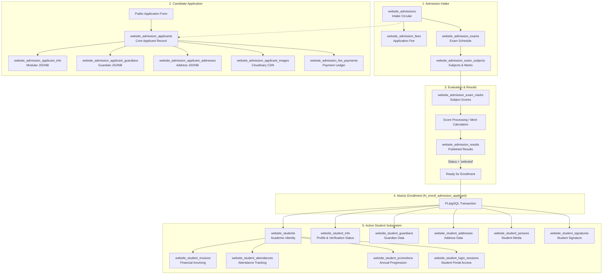
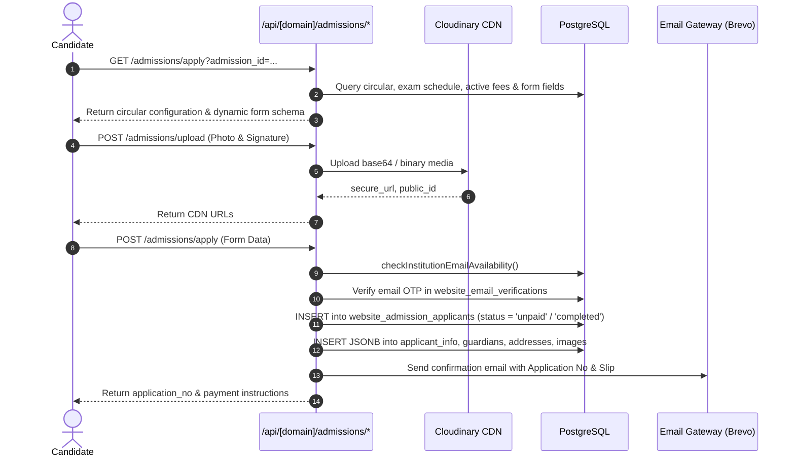
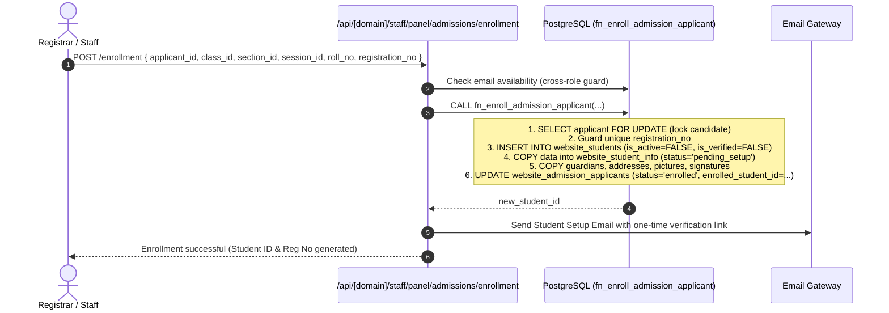

# Architecture & Operational Analysis: Admission, Applicants & Student Subsystems

## 1. Executive Summary & Architecture Overview

The educational platform implements a multi-tenant institutional operating system where each tenant institution (`websites.id`) runs isolated admission campaigns, applicant screening pipelines, enrollment workflows, and student life-cycle systems.

The core architecture is built upon a **decoupled pipeline**:
1. **Intake / Campaign Phase (`website_admissions`)**: Institutions publish circulars, configure eligibility (age, GPA, quota), admission fees, and selection methods (`manual`, `merit`, `exam`).
2. **Applicant Submission Phase (`website_admission_applicants`)**: Candidates apply publicly, upload photos and signatures to Cloudinary, verify email OTP, and complete modular form fields.
3. **Screening & Processing Phase**: Automated status segregation (`incomplete`, `unpaid`, `completed`), exam scheduling, subject-wise marking, merit position calculation, and circular result publication.
4. **Atomic Enrollment Transition (`fn_enroll_admission_applicant`)**: Selected candidates are transitioned into the formal academic registry (`website_students`) via an atomic PostgreSQL stored procedure.
5. **Student Life-Cycle Phase**: Secure credential setup, student profile verification, student ID generation, attendance, exam registrations, financial invoicing (`website_student_invoices`), and academic progression (`website_student_promotions`).

---

## 2. Comprehensive Database Schema Analysis

### 2.1 Admission Subsystem Tables

#### 1. `website_admissions` (Intake Circulars / Campaigns)
- **Primary Key**: `id BIGSERIAL`
- **Foreign Keys**:
  - `website_id BIGINT REFERENCES websites(id) ON DELETE CASCADE`
  - `department_id BIGINT REFERENCES website_departments(id) ON DELETE SET NULL`
  - `session_id BIGINT REFERENCES website_sessions(id) ON DELETE SET NULL`
  - `class_id BIGINT REFERENCES website_classes(id) ON DELETE SET NULL`
  - `created_by_staff_id BIGINT REFERENCES website_staffs(id) ON DELETE SET NULL`
- **Key Columns**:
  - `title VARCHAR(255) NOT NULL`, `description TEXT`
  - `start_date DATE NOT NULL`, `end_date DATE NOT NULL`
  - `exam_date DATE`, `result_date DATE`
  - `min_age INT`, `max_age INT`, `capacity INT DEFAULT 100`
  - `status VARCHAR(50) DEFAULT 'open'` (`open`, `closed`, `upcoming`, `archived`)
  - `selection_method VARCHAR(50) DEFAULT 'manual'` (`exam`, `merit`, `manual`)
  - `is_published BOOLEAN DEFAULT TRUE`
  - `is_result_published BOOLEAN DEFAULT FALSE`, `result_published_at TIMESTAMPTZ`
  - Academic criteria: `last_class TEXT`, `last_class_grade NUMERIC(4,2)`, `last_institution TEXT`
- **Indexes**: `idx_ws_adm_web (website_id)`, `idx_ws_adm_class (website_id, class_id)`, `idx_ws_adm_status (website_id, status)`.

#### 2. `website_admission_exams` (Exam Configuration)
- **Primary Key**: `id BIGSERIAL`
- **Constraints**: `UNIQUE(admission_id)` (Strict 1:1 relationship with circular)
- **Foreign Keys**: `admission_id REFERENCES website_admissions(id) ON DELETE CASCADE`
- **Key Columns**:
  - `exam_date TIMESTAMPTZ`, `admit_publish_date TIMESTAMPTZ`
  - `venue VARCHAR(255)`, `instructions TEXT`
- **Indexes**: `idx_ws_adm_exams_web (website_id)`, `idx_ws_adm_exams_adm (admission_id)`.

#### 3. `website_admission_exam_subjects` (Exam Subjects & Weights)
- **Primary Key**: `id BIGSERIAL`
- **Foreign Keys**:
  - `admission_id REFERENCES website_admissions(id) ON DELETE CASCADE`
  - `admission_exam_id REFERENCES website_admission_exams(id) ON DELETE CASCADE`
- **Key Columns**:
  - `title VARCHAR(150) NOT NULL` (e.g. Mathematics, English, General Science)
  - `mark NUMERIC(6, 2) DEFAULT 100.00 CHECK (mark >= 0)`
  - `time VARCHAR(50) DEFAULT '1 hour'`

#### 4. `website_admission_fees` (Intake Fee Structure)
- **Primary Key**: `id BIGSERIAL`
- **Foreign Keys**: `admission_id REFERENCES website_admissions(id) ON DELETE CASCADE`
- **Key Columns**:
  - `fee_title VARCHAR(255) DEFAULT 'Application Form Fee'`
  - `amount NUMERIC(10, 2) DEFAULT 0.00 CHECK (amount >= 0)`
  - `currency VARCHAR(10) DEFAULT 'BDT'`
  - `late_fee NUMERIC(10, 2) DEFAULT 0.00`
  - `status VARCHAR(50) DEFAULT 'active'` (`active`, `inactive`)

#### 5. `website_admission_applicants` (Core Candidate Submissions)
- **Primary Key**: `id BIGSERIAL`
- **Unique Constraints**:
  - `UNIQUE(website_id, application_no)`: Tenant-isolated application numbers.
  - `idx_website_admission_applicants_unique_lower_email`: Unique lowercase email per website.
- **Foreign Keys**:
  - `admission_id REFERENCES website_admissions(id) ON DELETE CASCADE`
  - `enrolled_student_id REFERENCES website_students(id) ON DELETE SET NULL`
  - `selected_by_staff_id REFERENCES website_staffs(id) ON DELETE SET NULL`
- **Lifecycle Statuses (`CHECK status IN (...)`)**:
  - `incomplete`: Started but abandoned before final submission.
  - `unpaid`: Application submitted, pending fee gateway payment.
  - `paid` / `completed`: Valid submission ready for academic review.
  - `selected` / `accepted`: Candidate approved for enrollment.
  - `rejected`: Candidate disqualified or failed admission test.
  - `enrolled`: Candidate transitioned into `website_students`.
- **Examination Columns**:
  - `exam_roll VARCHAR(50)`: Generated roll for admit card.
  - `score NUMERIC(6, 2) DEFAULT 0.00`, `merit_position INT`
  - `is_admit_card_issued BOOLEAN DEFAULT FALSE`, `admit_card_issued_at TIMESTAMPTZ`

#### 6. Modular Applicant Extension Tables (EAV / JSONB Pattern)
- `website_admission_applicant_info`: Stores modular personal questionnaire data in `data JSONB`.
- `website_admission_applicant_guardians`: Stores father/mother/guardian occupation, phone, NID in `data JSONB`.
- `website_admission_applicant_addresses`: Stores present and permanent addresses in `data JSONB`.
- `website_admission_applicant_images`: Stores Cloudinary URLs and public IDs (`photo_url`, `photo_public_id`, `signature_url`, `signature_public_id`).

#### 7. `website_admission_fee_payments` (Form Purchase Financial Ledger)
- **Primary Key**: `id BIGSERIAL`
- **Foreign Keys**:
  - `applicant_id REFERENCES website_admission_applicants(id) ON DELETE CASCADE`
  - `admission_id REFERENCES website_admissions(id) ON DELETE CASCADE`
  - `gateway_account_id REFERENCES website_payment_gateway_accounts(id) ON DELETE SET NULL`
- **Key Columns**:
  - `gateway_code VARCHAR(50)` (e.g. `bkash`, `shurjopay`, `offline`, `manual`)
  - `amount NUMERIC(10, 2)`, `transaction_id VARCHAR(100)`, `invoice_no VARCHAR(100)`
  - `payment_status VARCHAR(50)` (`pending`, `paid`, `failed`)
  - `paid_date TIMESTAMPTZ`

#### 8. `website_admission_exam_marks` & `website_admission_results`
- `website_admission_exam_marks`: Subject-level marks per candidate (`UNIQUE(admission_id, subject_id, applicant_id)`).
- `website_admission_results`: Final published merit list (`UNIQUE(admission_id, applicant_id)`). Contains `roll_no`, `merit_position`, `score`, `selection_status` (`selected`, `waiting`, `rejected`).

---

### 2.2 Student Subsystem Tables

#### 1. `website_students` (Core Student Academic Identity)
- **Primary Key**: `id BIGSERIAL`
- **Unique Constraints**:
  - `UNIQUE(website_id, registration_no)`: Institutional student registration number.
  - `UNIQUE(website_id, student_unique_id)`: System-wide alphanumeric UID (e.g. `STU-123456-A1B2`).
  - `idx_website_students_unique_lower_email`: Prevents duplicate email across active students in tenant.
- **Foreign Keys**:
  - `department_id REFERENCES website_departments(id) ON DELETE SET NULL`
  - `class_id REFERENCES website_classes(id) ON DELETE SET NULL`
  - `section_id REFERENCES website_sections(id) ON DELETE SET NULL`
  - `session_id REFERENCES website_sessions(id) ON DELETE SET NULL`
  - `admission_applicant_id REFERENCES website_admission_applicants(id) ON DELETE SET NULL` (Provenance trace)
  - `verified_by_staff_id REFERENCES website_staffs(id) ON DELETE SET NULL`
- **Security & Setup Columns**:
  - `password TEXT`: Bcrypt hash (null until student completes onboarding).
  - `verification_token VARCHAR(255)`, `verification_token_expires TIMESTAMPTZ`: Single-use setup token.
  - `recovery_token VARCHAR(255)`, `recovery_token_expires TIMESTAMPTZ`: Password reset token.
  - `two_factor_code VARCHAR(50)`, `two_factor_expires TIMESTAMPTZ`: 6-digit OTP code for setup verification.
  - `is_active BOOLEAN DEFAULT FALSE`: Becomes `TRUE` once setup is completed.
  - `is_verified BOOLEAN DEFAULT FALSE`: Becomes `TRUE` when staff approves submitted profile.
  - `last_login TIMESTAMPTZ`

#### 2. `website_student_info` (Verification State & Modular Profile)
- **Primary Key**: `id BIGSERIAL`, `UNIQUE(student_id)`
- **Key Columns**:
  - `data JSONB DEFAULT '{}'`: Dynamic field values mapped against `website_form_fields`.
  - `verification_status VARCHAR(50) DEFAULT 'pending_setup'` (`pending_setup`, `submitted`, `verified`, `rejected`).
  - `is_registered BOOLEAN DEFAULT FALSE`
  - `verification_notes TEXT`, `rejection_reason TEXT`

#### 3. Student Profile Extensions
- `website_student_guardians`: `UNIQUE(student_id)`, `data JSONB`.
- `website_student_addresses`: `UNIQUE(student_id)`, `data JSONB`.
- `website_student_pictures`: `image_url TEXT`, `image_id VARCHAR(255)`, `is_primary BOOLEAN`.
- `website_student_signatures`: `UNIQUE(student_id)`, `signature_url TEXT`, `signature_id VARCHAR(255)`.
- `website_student_login_sessions`: Tracks JWT session tokens, IP address, user agent, expiration.

#### 4. `website_form_fields` (Unified Meta-Schema Engine)
Both `website_admission_applicant_info` and `website_student_info` are governed by `website_form_fields`:
- `target_scope`: `info`, `guardians`, `addresses`, `academic`, `custom`
- `field_key VARCHAR(100)`, `label VARCHAR(150)`, `field_type` (`text`, `number`, `select`, `multiselect`, `date`, `file`, `textarea`, `boolean`)
- `validation_regex VARCHAR(255)`, `is_required BOOLEAN`, `is_unique BOOLEAN`
- `is_visible_in_admission BOOLEAN`, `is_visible_in_student BOOLEAN`, `is_visible_in_id_card BOOLEAN`

---

## 3. End-to-End Operational Workflows

### 3.1 Public Candidate Intake Workflow

### 3.2 Candidate Screening, Exam & Result Workflow

1. **Spam & Incomplete Segregation**:
   - `/staff-panel/admission-incomplete`: Shows candidates who dropped off before submission (`status = 'incomplete'`).
   - `/staff-panel/admission-spams`: Shows candidate submissions with unpaid application fees (`status = 'unpaid'`).
   - `/staff-panel/admission-applicants`: Shows verified submissions (`status NOT IN ('incomplete', 'unpaid')`).
2. **Admit Card Issuance**:
   - Staff triggers bulk or individual admit card generation via `/api/[domain]/staff/panel/admissions/applicants`.
   - The system generates unique `exam_roll` per circular, marks `is_admit_card_issued = TRUE`.
   - Candidate downloads official admit card at `/admission/admit-card`.
3. **Marks Entry & Merit Processing**:
   - For exam-based circulars, subject marks are entered via `/api/[domain]/staff/panel/admissions/exam-marks`.
   - The route `/api/[domain]/staff/panel/admissions/exam-marks/process` aggregates total scores, resolves tie-breakers, assigns `merit_position`, and updates `score`.
4. **Result Publication & Selection**:
   - Circular result is published via `/api/[domain]/staff/panel/admissions/results/publish`.
   - Sets `status = 'selected'` for candidates within intake capacity.

### 3.3 Atomic Student Enrollment Workflow

When an authorized staff member approves a selected candidate:

### 3.4 Student Onboarding & Verification

1. **Invitation Receipt**: Student receives an email containing a link with a cryptographically secure token: `https://[domain].baseurl/auth/student/setup?token=[TOKEN]`.
2. **Identity Verification & OTP**:
   - Student visits the setup page. `/api/[domain]/student/setup` validates the token.
   - OTP code sent via `/api/[domain]/student/setup/send-code`.
   - Verified via `/api/[domain]/student/setup/verify-code`.
3. **Credential Setup & Profile Update**:
   - Student sets their permanent password (hashed with Bcrypt) and completes any missing student information.
   - Status transitions to `is_active = TRUE`, `verification_status = 'submitted'`, `is_registered = TRUE`.
4. **Administrative Verification Desk**:
   - Staff navigates to `/staff-panel/student-verify`.
   - Staff inspects uploaded certificates, photos, guardian details.
   - On approval: sets `is_verified = TRUE`, `verification_status = 'verified'`, and records `verified_by_staff_id`.

---

## 4. Detailed API Route Specifications

| Route Path | Method | Auth / Guard | Primary Purpose | Database Tables Touched |
| :--- | :--- | :--- | :--- | :--- |
| `/api/[domain]/admissions/apply` | `GET` | Public | Returns open circulars, fee rules, exam venues & subjects | `website_admissions`, `website_classes`, `website_sessions`, `website_departments`, `website_admission_fees`, `website_admission_exams`, `website_admission_exam_subjects` |
| `/api/[domain]/admissions/apply` | `POST` | Public + Email Guard | Creates applicant record, validates email OTP, stores JSONB modules | `website_admission_applicants`, `website_admission_applicant_info`, `website_admission_applicant_guardians`, `website_admission_applicant_addresses`, `website_admission_applicant_images`, `website_admission_fee_payments`, `website_email_verifications` |
| `/api/[domain]/admissions/upload` | `POST` | Public / Rate-Limited | Uploads candidate photograph and signature to Cloudinary | Cloudinary CDN (`school_[id]/admissions`) |
| `/api/[domain]/admissions/admit-card` | `GET` | Public Candidate | Downloads or previews candidate admit card by `application_no` or `exam_roll` | `website_admission_applicants`, `website_admissions`, `website_admission_exams`, `website_admission_applicant_images` |
| `/api/[domain]/admissions/lookup` | `GET` | Public Candidate | Checks real-time admission application status | `website_admission_applicants`, `website_admission_fee_payments`, `website_admission_results` |
| `/api/[domain]/admissions/results` | `GET` | Public Candidate | Fetches published intake merit list and selection status | `website_admission_results`, `website_admissions` |
| `/api/[domain]/staff/panel/admissions` | `GET`, `POST`, `PUT`, `DELETE` | Staff / Officer (`admissions`) | Full CRUD for intake circular campaigns, exam dates, capacity | `website_admissions`, `website_admission_exams`, `website_admission_exam_subjects`, `website_admission_fees` |
| `/api/[domain]/staff/panel/admissions/applicants` | `GET`, `PUT`, `DELETE` | Staff / Officer (`admissions`) | Desk for screening, status toggling (`selected`, `rejected`), admit card issuance | `website_admission_applicants`, `website_admission_applicant_info`, `website_admission_fee_payments`, `website_admission_applicant_images` |
| `/api/[domain]/staff/panel/admissions/enrollment` | `GET`, `POST` | Staff / Officer (`admissions` / `students`) | Enrolls selected candidates into `website_students` via stored procedure | `website_admission_applicants`, `website_students`, `website_student_info`, `fn_enroll_admission_applicant()` |
| `/api/[domain]/staff/panel/admissions/exam-marks` | `GET`, `POST` | Staff / Officer (`admissions`) | Records subject-level admission exam marks per candidate | `website_admission_exam_marks`, `website_admission_exam_subjects` |
| `/api/[domain]/staff/panel/admissions/results/publish`| `POST` | Staff / Officer (`admissions`) | Calculates merit ranks and publishes results | `website_admission_results`, `website_admissions`, `website_admission_applicants` |
| `/api/[domain]/staff/panel/students` | `GET`, `POST`, `PUT`, `DELETE` | Staff / Officer (`students`) | Comprehensive student registry workstation | `website_students`, `website_student_info`, `website_student_guardians`, `website_student_addresses`, `website_student_pictures`, `website_student_signatures` |
| `/api/[domain]/staff/panel/students/verify` | `GET`, `PUT` | Staff / Officer (`students`) | Review submitted student profiles and approve/reject verification | `website_students`, `website_student_info` |
| `/api/[domain]/staff/panel/students/bulk` | `POST` | Staff / Officer (`students`) | Bulk CSV / Excel student roster import | `website_students`, `website_student_info` |
| `/api/[domain]/student/setup` | `GET`, `POST` | Token / Public OTP | Student onboarding: set initial password and confirm details | `website_students`, `website_student_info`, `website_student_pictures`, `website_student_signatures` |
| `/api/[domain]/student/login` | `POST` | Public Student | Authenticates student with email/registration_no + password, issues JWT | `website_students`, `website_student_login_sessions` |
| `/api/[domain]/student/me` | `GET` | Student Session | Returns active student academic context and profile | `website_students`, `website_student_info`, `website_classes`, `website_sections`, `website_sessions` |

---

## 5. Security, Tenancy & Integrity Constraints

1. **Tenant Isolation**:
   Every query explicitly scopes rows with `WHERE website_id = $1` or joins to parents that enforce `website_id`. Foreign key references utilize `ON DELETE CASCADE` so deleting a tenant website cleanly cascades across all applicants, students, exams, and financial ledgers.
2. **Cross-Role Email Guard (`checkInstitutionEmailAvailability`)**:
   An institution prohibits conflicting email registrations across roles. An email registered to a teacher, staff, or active student cannot be hijacked by an applicant, and an enrolled student cannot submit duplicate applications under other roles.
3. **Database-Level Transaction Locking**:
   In `fn_enroll_admission_applicant`, `SELECT ... FOR UPDATE` locks the applicant record. This prevents concurrent race conditions where two staff members might double-enroll the same applicant simultaneously.
4. **Credential Isolation**:
   Student passwords are encrypted with `bcrypt` (10 rounds). Sensitive tokens (`verification_token`, `recovery_token`) include strict timestamp expiration (`verification_token_expires`), invalidating stale links.

---

## 6. Summary of Key Architectural Insights

1. **Dual Schema Pattern (Structured Relational + JSONB Modular Extension)**:
   Core identity attributes (`name`, `registration_no`, `roll_no`, `email`, `phone`, `gender`, `date_of_birth`, foreign keys) are strongly typed relational columns with B-tree indexes. Dynamic institutional attributes (medical history, blood group, extracurriculars, custom questions) are stored in `data JSONB`, dynamically driven by `website_form_fields`.
2. **Audit Trails & Provenance**:
   When an applicant is converted to a student, the field `website_students.admission_applicant_id` retains the link to the applicant record, while `website_admission_applicants.enrolled_student_id` and `enrolled_at` record the exact conversion timestamp.
3. **Clean Desk Segregation**:
   The staff panel divides the applicant pipeline into specialized desks:
   - Incomplete registrations $\rightarrow$ `/staff-panel/admission-incomplete`
   - Unpaid spam submissions $\rightarrow$ `/staff-panel/admission-spams`
   - Verified active applicants $\rightarrow$ `/staff-panel/admission-applicants`
   - Selected candidates awaiting registration $\rightarrow$ `/staff-panel/admission-enrollment`
   - Registered student verification $\rightarrow$ `/staff-panel/student-verify`

