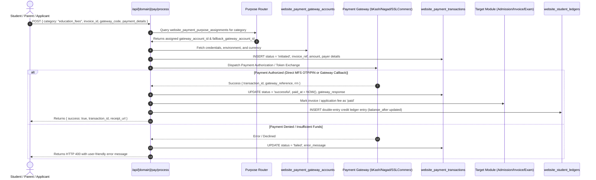
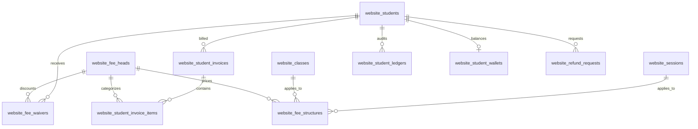

# Comprehensive Architecture Analysis: Payment Systems, Gateways & Data Infrastructure

**Scope:** Main Platform (SaaS Central) & Tenant Websites (Multi-Tenant Institution ERP)  
**Target Environment:** Next.js (App Router, JavaScript/JSX), PostgreSQL (`pg`), Supabase Multi-Tenant Engine  
**Last Updated:** Current System Architecture & Implementation

---

## 1. Executive Architectural Overview

The platform operates on a two-tier financial and data architecture:

```mermaid
flowchart TD
    subgraph TIER_1["Tier 1: Main Platform SaaS (Central Billing & Creators)"]
        PKG[packages<br/>Pricing, Quotas, Mail/SMS Limits]
        PUR[purchases<br/>Billing Orders & Invoices]
        PAY[payments<br/>Transactions & Gateway Response]
        SUB[subscriptions<br/>Active Tenant Subscriptions]
        WSH[wishlists<br/>Creator Bookmarks]
        CRT[creators<br/>Institution Owners]
        SBC[subscribers<br/>Marketing Newsletter Leads]
        
        GW_CENTRAL["Central SaaS Gateways<br/>Paddle (Global USD) & bKash Tokenized (Local BDT)"]
        
        CRT --> PUR
        PKG --> PUR
        PUR --> PAY
        PAY --> GW_CENTRAL
        PAY -->|Success| SUB
    end

    subgraph TIER_2["Tier 2: Tenant Website ERP (Institutional Fee Collections)"]
        W_CUR[website_currencies<br/>Multi-Currency & Base Rates]
        W_GW[website_payment_gateways<br/>Catalog of Supported Providers]
        W_ACC[website_payment_gateway_accounts<br/>Tenant Credentials & Sandbox/Live]
        W_ROU[website_payment_purpose_assignments<br/>Purpose-to-Gateway Mapping & Fallback]
        W_TX[website_payment_transactions<br/>Central Institutional Audit Ledger]
        W_RCP[website_payment_receipt_templates<br/>Customizable HTML/Fabric Receipts]
        
        W_ACC --> W_ROU
        W_ROU --> W_TX
        W_TX --> W_RCP
    end

    subgraph TIER_2_MODULES["Institutional Fee Collection Modules"]
        ADM_PAY[website_admission_fee_payments<br/>Candidate Form Purchase]
        EDU_PAY[website_education_fee_payments<br/>Tuition & Term Dues]
        EXM_PAY[website_exam_fee_payments<br/>Exam Registration & Admit Cards]
        HAL_PAY[website_hall_fee_payments<br/>Hostel & Seat Rent]
        INV_PAY[website_student_invoices & items<br/>Itemized Monthly Bills]
        LEDGER[website_student_ledgers<br/>Double-Entry Running Balance]
        WALLET[website_student_wallets<br/>Advance Prepayments]
        REFUND[website_refund_requests<br/>Refund Approvals Workflow]
        
        W_TX --> ADM_PAY
        W_TX --> EDU_PAY
        W_TX --> EXM_PAY
        W_TX --> HAL_PAY
        W_TX --> INV_PAY
        INV_PAY --> LEDGER
        W_TX --> WALLET
        WALLET --> REFUND
    end

    subgraph DATA_INFRA["Data Infrastructure, Monitoring & Quotas"]
        USG[website_monthly_usages<br/>Monthly Email & SMS Counts]
        STR[website_storage_usages<br/>Storage Bytes per Type]
        QTA[website_usage_quotas<br/>Package Limits Enforcement]
        MED[website_media_files<br/>Cloudinary CDN Asset Registry]
        WEB[website_webhook_events<br/>Idempotent Webhook Log]
        JOB[website_background_jobs<br/>Async Job Queue & Retries]
        API[website_api_keys<br/>Scoped REST API Keys]
        
        SUB -.->|Enforces Quotas| QTA
        SUB -.->|Determines Limits| USG
    end
```



---

## 2. Tier 1: Main Platform (SaaS) Payment & Subscription Systems

The main platform hosts central marketing, creator onboarding, and institutional subscription billing.

### 2.1 Core Tables in [`psql/schema.psql`](file:///d:/code/sii/psql/schema.psql)

| Table | Purpose & Constraints | Key Columns |
| :--- | :--- | :--- |
| `packages` | Master SaaS tiers available for creators to subscribe their institutions to. Includes pricing, module inclusions, capacity limits, and usage quotas. | `id`, `name`, `slug`, `monthly_price_usd`, `yearly_price_usd`, `monthly_price_bdt`, `yearly_price_bdt`, `discount_percentage`, `max_students`, `max_teachers`, `max_staff`, `max_storage_mb`, `monthly_mail`, `monthly_sms`, `is_available_student_panel`, `is_available_teacher_panel`, `is_available_custom_domain`, `features` (JSONB), `is_popular`, `is_active`, `sort_order`. |
| `package_home_modules` | Junction table allocating specific public portal pages (`website_home_modules`) included in each package tier. | `id`, `package_id` (FK packages), `home_module_id` (FK website_home_modules), `created_at`, `UNIQUE (package_id, home_module_id)`. |
| `package_control_modules` | Junction table allocating specific staff control panel modules (`website_control_modules`) accessible in each package tier. | `id`, `package_id` (FK packages), `control_module_id` (FK website_control_modules), `created_at`, `UNIQUE (package_id, control_module_id)`. |
| `creators` | Registered institution founders, principals, or institutional administrators owning tenant websites. | `id`, `name`, `email` (UNIQUE), `password` (bcrypt), `phone`, `role` ('creator'), `is_active`, `is_verified`, `verification_token`, `country`, `city`, `address`. |
| `creator_login_sessions` | JWT and browser session records for authenticated creators. | `id`, `creator_id` (FK creators), `session_token` (UNIQUE), `ip_address`, `user_agent`, `expires_at`, `is_active`. |
| `subscribers` | Marketing email lead capture table for platform updates and promotions. | `id`, `email` (UNIQUE), `source`, `is_active`, `subscribed_at`. |
| `websites` | The core tenant entity. Represents an educational institution website provisioned by a creator. | `id`, `creator_id` (FK creators), `name`, `subdomain` (UNIQUE), `domain` (custom domain), `currency` (DEFAULT 'BDT'), `storage_used`, `status` ('active', 'suspended', 'pending'), `created_at`. |
| `purchases` | Formal order bill generated when a creator purchases or renews an institution package. | `id`, `creator_id` (FK creators), `website_id` (FK websites), `package_id` (FK packages), `purchase_code` (VARCHAR(100) UNIQUE), `billing_cycle` ('monthly', 'yearly', 'lifetime', 'custom'), `base_amount`, `discount_amount`, `tax_amount`, `total_amount`, `status` ('pending', 'completed', 'failed', 'refunded', 'cancelled'), `period_start`, `period_end`, `invoice_pdf_url`, `notes`. |
| `payments` | Individual financial transaction records executing a purchase order through a payment gateway. | `id`, `purchase_id` (FK purchases), `creator_id` (FK creators), `transaction_id` (VARCHAR(100) UNIQUE), `amount`, `currency` (DEFAULT 'USD'), `payment_method` (DEFAULT 'Paddle'), `payment_gateway` (VARCHAR(100)), `gateway_fee`, `gateway_response` (JSONB), `status` ('pending', 'successful', 'failed', 'refunded', 'cancelled'), `payment_date`. |
| `subscriptions` | Active recurring institutional subscription link connecting a tenant `website_id` to a `package_id`. | `id`, `creator_id` (FK creators), `website_id` (FK websites), `package_id` (FK packages), `purchase_id` (FK purchases), `status` ('active', 'trailing', 'past_due', 'cancelled', 'expired'), `billing_cycle` ('monthly', 'yearly', 'lifetime', 'custom'), `current_period_start`, `current_period_end`, `cancel_at_period_end`. |
| `wishlists` | Saved packages favorited by creators for later upgrade. | `id`, `creator_id` (FK creators), `package_id` (FK packages), `UNIQUE (creator_id, package_id)`. |

---

### 2.2 Tier 1 Payment Gateways & Processing Logic

1. **Paddle Gateway (International USD Billing)**:
   - Module: [`src/lib/database/paddle.js`](file:///d:/code/sii/src/lib/database/paddle.js)
   - Handles global credit/debit cards (Visa, Mastercard, Amex), PayPal, Apple Pay, and Google Pay.
   - Flow:
     1. Creator selects a package and chooses USD billing.
     2. Backend generates a purchase code in `purchases` and calls `createPaddleTransaction()`.
     3. Paddle checkout overlay or hosted URL opens for the customer.
     4. On successful checkout, Paddle webhook or client redirect calls `/api/marketing/creator/payments` with `transaction_id`.
     5. Backend fetches transaction details via `getPaddleTransaction()`, validates currency, amount, and status.
     6. Updates `payments` to `successful`, `purchases` to `completed`, and updates or inserts into `subscriptions` setting `current_period_end` based on billing interval (30 days for monthly, 365 days for yearly).
2. **bKash Tokenized Gateway (Local Bangladesh BDT Billing)**:
   - Module: [`src/lib/database/bkash.js`](file:///d:/code/sii/src/lib/database/bkash.js)
   - API Routes:
     - [`/api/marketing/creator/payments/bkash`](file:///d:/code/sii/src/app/api/marketing/creator/payments/bkash/route.js) (Initiate payment)
     - [`/api/marketing/creator/payments/bkash/callback`](file:///d:/code/sii/src/app/api/marketing/creator/payments/bkash/callback/route.js) (Execute & finalize payment)
   - Flow:
     1. Validates creator mobile number using `validateBangladeshiMobile()`.
     2. Requests token from bKash API using `BKASH_APP_KEY`, `BKASH_APP_SECRET`, `BKASH_USERNAME`, and `BKASH_PASSWORD`.
     3. Initiates payment with bKash API and returns `paymentID` and redirect URL.
     4. On callback, executes `executeBkashPayment()`, validates transaction status, and updates `payments` and `subscriptions`.
3. **Manual / Bank Transfer Verification**:
   - Creator submits offline deposit receipt or transaction reference.
   - Developer/Admin reviews and approves via `/api/marketing/developer/payments`, which atomically transitions `purchases.status = 'completed'` and activates `subscriptions`.

---

### 2.3 Tier 1 API Structure

| Route Path | Method | Auth Required | Purpose |
| :--- | :--- | :--- | :--- |
| `/api/marketing/packages` | `GET` | Public | Lists all active public packages, dual currency pricing (USD/BDT), and included modules. |
| `/api/marketing/creator/purchases` | `GET`, `POST` | Creator Session | Lists creator purchase history or creates a pending purchase order for an institution. |
| `/api/marketing/creator/payments` | `GET`, `POST` | Creator Session | Retrieves payment receipts or processes Paddle gateway transaction verification. |
| `/api/marketing/creator/payments/bkash` | `POST` | Creator Session | Initializes bKash payment checkout for BDT subscription purchase. |
| `/api/marketing/creator/payments/bkash/callback` | `GET`, `POST` | bKash IPN / Redirect | Finalizes bKash payment execution and activates institutional subscription. |
| `/api/marketing/creator/subscriptions` | `GET`, `PATCH` | Creator Session | Displays active subscription tier, remaining period, and handles renewal or cancellation. |
| `/api/marketing/developer/packages` | `GET`, `POST`, `PUT` | Developer (Module Perm) | Developer CRUD for SaaS package tiers, capacities, prices, and monthly email/SMS limits. |
| `/api/marketing/developer/packages/[slug]` | `GET`, `PUT`, `DELETE`| Developer (Module Perm) | Edit or delete specific package tier by slug or ID. |
| `/api/marketing/developer/purchases` | `GET`, `PATCH` | Developer (Module Perm) | Developer oversight of all platform purchases, manual payment confirmation, and invoicing. |
| `/api/marketing/developer/payments` | `GET`, `PATCH` | Developer (Module Perm) | Global payment audit log across all creators and gateways. |
| `/api/marketing/developer/subscriptions` | `GET`, `PUT` | Developer (Module Perm) | Manual subscription override, extension, or tier upgrade. |

---

## 3. Tier 2: Tenant Website (Institutional ERP) Payment Gateway Subsystem

Tenant websites have their own payment engine that processes institutional fee collections. All operations are isolated by `website_id`.

### 3.1 Core Gateway Tables in [`psql/website_tables.psql`](file:///d:/code/sii/psql/website_tables.psql)

#### 1. `website_currencies` (Multi-Currency Operating Engine)
Manages institutional operational currencies, base currency designation, and real-time exchange rates.
- **Columns**: `id`, `website_id` (FK websites), `code` (VARCHAR(10) e.g., 'BDT', 'USD', 'EUR'), `name`, `symbol` (DEFAULT '৳'), `exchange_rate` (NUMERIC(12,4) DEFAULT 1.0000), `is_base_currency` (BOOLEAN DEFAULT FALSE), `is_active` (BOOLEAN DEFAULT TRUE), `created_at`, `updated_at`.
- **Constraint**: `UNIQUE (website_id, code)`.
- **Preloaded Currencies**: `BDT`, `USD`, `EUR`, `GBP`, `INR`, `CAD`, `AUD`, `AED`, `SAR`, `MYR`, `SGD`.

#### 2. `website_payment_gateways` (Platform Gateway Provider Registry)
Master catalog of payment gateways supported by the multi-tenant architecture.
- **Columns**: `id`, `code` (VARCHAR(50) UNIQUE e.g. 'bkash', 'nagad', 'sslcommerz', 'stripe'), `name`, `category` ('mobile_banking', 'card_processing', 'bank_transfer', 'aggregator', 'manual'), `description`, `logo_icon`, `website_url`, `supported_currencies` (TEXT[]), `credential_schema` (JSONB defining required keys: e.g. `store_id`, `store_passwd`, `app_key`, `secret_key`), `is_active`.
- **Supported Providers**:
  - `bkash` (bKash Checkout / Direct API)
  - `nagad` (Nagad Online Payment)
  - `rocket` (DBBL Rocket)
  - `sslcommerz` (SSLCommerz Hosted Checkout)
  - `surjopay` (Shurjopay Payment Gateway)
  - `eps` (Electronic Payment Software)
  - `sonali_gateway` (Sonali Bank Institutional Gateway)
  - `stripe` (Stripe Global Cards)
  - `paypal` (PayPal Checkout)
  - `paddle` (Paddle Global Invoicing)
  - `razorpay` (Razorpay India / International)

#### 3. `website_payment_gateway_accounts` (Tenant Gateway Credentials)
Stores institutional gateway credentials configured by school administrators.
- **Columns**:
  - `id` (BIGSERIAL PRIMARY KEY)
  - `website_id` (BIGINT NOT NULL REFERENCES `websites(id)` ON DELETE CASCADE)
  - `gateway_code` (VARCHAR(50) NOT NULL REFERENCES `website_payment_gateways(code)`)
  - `account_name` (VARCHAR(150) NOT NULL): Display name (e.g. "Main Campus bKash Merchant").
  - `account_number` (VARCHAR(100)): Merchant phone or merchant account number.
  - `environment` (VARCHAR(20) DEFAULT 'sandbox' CHECK `('sandbox', 'live')`)
  - `currency` (VARCHAR(10) DEFAULT 'BDT')
  - `credentials` (JSONB NOT NULL DEFAULT `'{}'::jsonb`): Store ID, password, API secret, etc.
  - `is_active` (BOOLEAN DEFAULT TRUE) & `is_default` (BOOLEAN DEFAULT FALSE)
  - `notes` (TEXT) & `created_by_staff_id` (BIGINT REFERENCES `website_staffs(id)`)
- **Security Features**:
  - Secret fields (`app_secret`, `secret_key`, `store_passwd`, `private_key`) are masked via `maskAccountCredentials()` on API output.
  - Safe editing via `mergeCredentials()` prevents wiping existing secrets if left blank on update.

#### 4. `website_payment_purpose_assignments` (Smart Purpose-Based Gateway Routing)
Maps different institutional revenue streams to specific gateway accounts.
- **Columns**:
  - `id` (BIGSERIAL PRIMARY KEY)
  - `website_id` (BIGINT NOT NULL REFERENCES `websites(id)` ON DELETE CASCADE)
  - `purpose` (VARCHAR(100) NOT NULL CHECK `('residential_fees', 'education_fees', 'exam_fees', 'admission_fees', 'other_fees')`)
  - `hostel_id` (BIGINT REFERENCES `website_hostels(id)` ON DELETE CASCADE DEFAULT NULL): Enables specific residential halls to route payments to separate dedicated merchant accounts.
  - `title` (VARCHAR(150) NOT NULL) & `description` (TEXT)
  - `gateway_account_id` (BIGINT NOT NULL REFERENCES `website_payment_gateway_accounts(id)`)
  - `fallback_gateway_account_id` (BIGINT REFERENCES `website_payment_gateway_accounts(id)`)
  - `is_active` (BOOLEAN DEFAULT TRUE)
  - `allow_student_portal` (BOOLEAN DEFAULT TRUE): Visible inside authenticated student dashboard.
  - `allow_public_checkout` (BOOLEAN DEFAULT TRUE): Visible on public non-authenticated forms (e.g. admission applicant checkout).
  - `assigned_by_staff_id` (BIGINT REFERENCES `website_staffs(id)`)

#### 5. `website_payment_transactions` (Unified Institutional Transaction Ledger)
The master audit log of every financial transaction processed by the institution.
- **Columns**:
  - `id` (BIGSERIAL PRIMARY KEY)
  - `website_id` (BIGINT NOT NULL REFERENCES `websites(id)` ON DELETE CASCADE)
  - `gateway_account_id` (BIGINT REFERENCES `website_payment_gateway_accounts(id)` ON DELETE SET NULL)
  - `gateway_code` (VARCHAR(50) NOT NULL)
  - `purpose` (VARCHAR(100) NOT NULL)
  - `invoice_ref` (VARCHAR(150)): External/internal invoice or application tracking number.
  - `student_id` (BIGINT REFERENCES `website_students(id)` ON DELETE SET NULL)
  - `payer_name`, `payer_email`, `payer_phone` (VARCHAR)
  - `amount` (NUMERIC(12,2) NOT NULL CHECK `(amount >= 0)`)
  - `currency` (VARCHAR(10) DEFAULT 'BDT')
  - `environment` (VARCHAR(20) DEFAULT 'sandbox' CHECK `('sandbox', 'live')`)
  - `transaction_id` (VARCHAR(150)): Unique gateway transaction reference.
  - `gateway_reference` (VARCHAR(255)): Bank reference, RRN, or order token.
  - `gateway_response` (JSONB): Raw gateway payload archive for debugging.
  - `status` (VARCHAR(50) DEFAULT 'pending' CHECK `('pending', 'initiated', 'successful', 'failed', 'cancelled', 'refunded')`)
  - `fee_amount` (NUMERIC(10,2) DEFAULT 0.00): Processing fee deducted.
  - `net_amount` (NUMERIC(12,2)): Net amount credited to institution account.
  - `payment_method` (VARCHAR(50) DEFAULT 'online')
  - `paid_at` (TIMESTAMPTZ) & `error_message` (TEXT)
  - `receipt_url` (TEXT): Rendered HTML/PDF receipt view URL.
- **Indexes**: `idx_ws_pay_tx_web`, `idx_ws_pay_tx_gw`, `idx_ws_pay_tx_status`, `idx_ws_pay_tx_inv`, `idx_ws_pay_tx_student`.

#### 6. `system_payment_receipt_templates` & `website_payment_receipt_templates`
Customizable graphical and thermal receipt templates rendered upon successful payment.
- **Columns**: `id`, `website_id`, `system_template_id`, `name`, `dimension_width` (210.00 mm), `dimension_height` (297.00 mm), `dimension_unit` ('mm', 'px'), `custom_fabric_data` (JSONB for Fabric.js visual drag-and-drop designer), `custom_html`, `custom_css`, `custom_variables` (JSONB for dynamic merge tags: `{{student_name}}`, `{{invoice_no}}`, `{{amount}}`, `{{date}}`), `is_default`, `is_active`.

---

### 3.2 Tenant Payment Gateways: Processing Workflow

The processing engine is implemented in [`src/lib/database/paymentGateways.js`](file:///d:/code/sii/src/lib/database/paymentGateways.js) and [`src/app/api/[domain]/pay/process/route.js`](file:///d:/code/sii/src/app/api/%5Bdomain%5D/pay/process/route.js):



---

## 4. Tier 2: Student Financials, Billing & Double-Entry Ledger Subsystem

The institutional accounting subsystem manages fee structures, waivers, monthly student invoices, advance student wallets, and an immutable double-entry ledger.

### 4.1 Master Billing & Accounting Tables



#### 1. `website_fee_heads` (Chart of Accounts)
Catalog of revenue line items.
- **Columns**: `id`, `website_id`, `name` (VARCHAR(100)), `code` (VARCHAR(50)), `category` ('academic', 'admission', 'exam', 'transport', 'hostel', 'library', 'fines', 'other'), `is_taxable` (BOOLEAN DEFAULT FALSE), `is_active` (BOOLEAN DEFAULT TRUE).

#### 2. `website_fee_structures` (Class & Session Pricing Matrix)
Defines how much each class pays for each fee head, the billing frequency, and automatic late fine schedules.
- **Columns**: `id`, `website_id`, `head_id` (FK website_fee_heads), `class_id` (FK website_classes), `session_id` (FK website_sessions), `amount` (NUMERIC(12,2)), `frequency` ('one_time', 'monthly', 'quarterly', 'term', 'yearly'), `due_day` (INT DEFAULT 10), `fine_rule` (JSONB: e.g. `{"grace_days": 5, "fine_per_day": 10, "max_fine": 500}`).

#### 3. `website_fee_waivers` (Scholarships & Financial Aid Concessions)
Special financial reductions granted to specific students (e.g. merit scholarship, sibling concession, staff quota).
- **Columns**: `id`, `website_id`, `student_id` (FK website_students), `head_id` (FK website_fee_heads), `waiver_type` ('percentage', 'fixed_amount'), `waiver_value` (NUMERIC(10,2)), `reason` (VARCHAR(255)), `is_active` (BOOLEAN), `approved_by` (BIGINT).

#### 4. `website_student_invoices` (Monthly & Term Billing Statements)
Official billing statements compiled for students.
- **Columns**:
  - `id` (BIGSERIAL PRIMARY KEY)
  - `website_id` (BIGINT NOT NULL REFERENCES `websites(id)` ON DELETE CASCADE)
  - `student_id` (BIGINT NOT NULL REFERENCES `website_students(id)` ON DELETE CASCADE)
  - `invoice_no` (VARCHAR(100) NOT NULL UNIQUE e.g. `INV-2026-0819`)
  - `session_id` (BIGINT REFERENCES `website_sessions(id)`)
  - `month` (VARCHAR(20) e.g., '2026-11')
  - `subtotal` (NUMERIC(12,2) DEFAULT 0.00)
  - `waiver_total` (NUMERIC(12,2) DEFAULT 0.00)
  - `fine_total` (NUMERIC(12,2) DEFAULT 0.00)
  - `total_amount` (NUMERIC(12,2) DEFAULT 0.00): `subtotal - waiver_total + fine_total`
  - `paid_amount` (NUMERIC(12,2) DEFAULT 0.00)
  - `due_amount` (NUMERIC(12,2) DEFAULT 0.00)
  - `due_date` (DATE NOT NULL)
  - `status` (VARCHAR(50) DEFAULT 'unpaid' CHECK `('unpaid', 'partially_paid', 'paid', 'overdue', 'cancelled')`)

#### 5. `website_student_invoice_items` (Itemized Bill Breakdown)
- **Columns**: `id`, `website_id`, `invoice_id` (FK website_student_invoices), `head_id` (FK website_fee_heads), `title`, `amount`, `waiver_amount`, `fine_amount`, `net_amount`.

#### 6. `website_student_ledgers` (Immutable Double-Entry Financial Audit Trail)
Maintains the student's institutional financial balance.
- **Columns**:
  - `id` (BIGSERIAL PRIMARY KEY)
  - `website_id` (BIGINT NOT NULL REFERENCES `websites(id)` ON DELETE CASCADE)
  - `student_id` (BIGINT NOT NULL REFERENCES `website_students(id)` ON DELETE CASCADE)
  - `entry_type` (VARCHAR(50) NOT NULL CHECK `('debit', 'credit')`):
    - **Debit**: An invoice or fine issued (increases student payable due).
    - **Credit**: A payment received or waiver applied (reduces student payable due).
  - `account_category` (VARCHAR(50) DEFAULT 'fee')
  - `amount` (NUMERIC(12,2) NOT NULL)
  - `balance_after` (NUMERIC(12,2) NOT NULL): Running balance calculation immediately following transaction.
  - `reference_id` (VARCHAR(100)): Invoice number or transaction ID.
  - `description` (TEXT NOT NULL)
  - `created_at` (TIMESTAMPTZ DEFAULT CURRENT_TIMESTAMP)

#### 7. `website_student_wallets` (Prepaid Advance Balances)
Stores advance deposits where parents pay in bulk ahead of billing.
- **Columns**: `id`, `website_id`, `student_id` (UNIQUE FK website_students), `balance` (NUMERIC(12,2) DEFAULT 0.00), `last_deposited_at`, `created_at`, `updated_at`.

#### 8. `website_refund_requests` (Student Excess Payment Refund Workflow)
- **Columns**: `id`, `website_id`, `student_id`, `amount`, `reason`, `status` ('pending', 'approved', 'rejected', 'disbursed'), `approved_by`, `transaction_reference`.

---

### 4.2 Module-Specific Fee Tables in [`psql/website_tables.psql`](file:///d:/code/sii/psql/website_tables.psql)

In addition to general tuition invoices, specific campus operations have dedicated fee registers that link into `website_payment_transactions`:

| Module | Configuration Table | Payment Register Table | Purpose |
| :--- | :--- | :--- | :--- |
| **Admission Intake** | `website_admission_fees` | `website_admission_fee_payments` | Candidate application form purchase and intake processing. Status: `'pending', 'paid', 'failed'`. |
| **Examinations** | `website_exam_fees` | `website_exam_fee_payments` | Term exam registration, practical lab fee, admit card issuance clearance. |
| **Academic Tuition** | `website_education_fees` | `website_education_fee_payments` | Fast-track counter or portal tuition clearance by month and session. |
| **Residential Halls** | `website_hostels` / `website_halls` | `website_hall_fee_payments` | Monthly dormitory seat rent, utility, and dining hall fee receipts. |

---

## 5. Tier 2: Tenant Payment APIs Reference

### 5.1 Public & Student Payment Endpoints

| Route Path | Method | Auth Required | Purpose |
| :--- | :--- | :--- | :--- |
| `/api/[domain]/pay` | `GET` | Public / Student | Fetches active payment purpose routing, base currencies, and available gateway options for this institution. |
| `/api/[domain]/pay/process` | `POST` | Public / Student | Unified payment processor for all categories (`education_fees`, `exam_fees`, `admission_fees`, `residential_fees`). Validates account number/card, records in `website_payment_transactions`, executes payment, updates invoices, and returns receipt. |
| `/api/[domain]/pay/dues` | `GET` | Student Portal / Public | Queries outstanding unpaid dues across student tuition, exams, or residential halls using student ID or registration number. |
| `/api/[domain]/pay/admission-fees` | `POST` | Public Candidate | Processes candidate application form purchase and updates `website_admission_applicants.status = 'paid'`. |
| `/api/[domain]/pay/admission-fees/[id]` | `GET` | Public Candidate | Retrieves payment receipt and transaction verification for a specific admission fee invoice. |
| `/api/[domain]/pay/education-fees` | `POST` | Student Portal | Clears monthly education tuition fee invoice. |
| `/api/[domain]/pay/exam-fees` | `POST` | Student Portal | Clears examination fee and unlocks candidate admit card. |
| `/api/[domain]/pay/residential-fees` | `POST` | Student Portal | Clears hostel/dormitory monthly seat rent. |
| `/api/[domain]/student/fees` | `GET` | Authenticated Student | Lists student's itemized invoices (`website_student_invoices`), ledger balance (`website_student_ledgers`), and wallet credit. |
| `/api/[domain]/student/fees/pay` | `POST` | Authenticated Student | Initiates online gateway payment for student invoices from the student portal. |
| `/api/[domain]/student/receipts` | `GET` | Authenticated Student | Downloads printable HTML/PDF receipts for past student transactions. |

### 5.2 Staff Control Panel Payment Configuration Endpoints

| Route Path | Method | Auth Required | Purpose |
| :--- | :--- | :--- | :--- |
| `/api/[domain]/staff/panel/configure/payments` | `GET` | Staff / Creator | Fetches institution's configured gateway accounts, credential masks, purpose routing, currencies, and transaction metrics. |
| `/api/[domain]/staff/panel/configure/payments` | `POST` | Staff (Settings Perm) | Creates a new gateway account (`website_payment_gateway_accounts`) with credentials, environment (sandbox/live), and default flag. |
| `/api/[domain]/staff/panel/configure/payments` | `PUT` | Staff (Settings Perm) | Updates gateway account credentials using safe merge logic (`mergeCredentials`). |
| `/api/[domain]/staff/panel/configure/payments` | `DELETE`| Staff (Settings Perm) | Deletes or deactivates a gateway account. |
| `/api/[domain]/staff/panel/configure/payments/assign` | `POST`, `PUT` | Staff (Settings Perm) | Assigns or updates purpose routes (`website_payment_purpose_assignments`) mapping fee streams to primary and fallback gateway accounts. |
| `/api/[domain]/staff/panel/configure/payments/currencies` | `GET`, `POST`, `PUT` | Staff (Settings Perm) | Manages institutional currencies, updates exchange rates, and switches base currency in `website_currencies` and `websites`. |
| `/api/[domain]/staff/panel/configure/payments/test` | `POST` | Staff (Settings Perm) | Tests connectivity and credential validation for a gateway account. |

---

## 6. Data Infrastructure, Monitoring, Storage & System Tables

The platform contains data tables governing multi-tenancy, file storage, rate limits, background worker queues, and audit logs.

### 6.1 Quotas, Usages & Capacity Constraints

#### 1. `website_monthly_usages` (Email & SMS Quota Tracking)
Tracks consumption per tenant per calendar month (`year_month` e.g., `'2026-11'`).
- **Columns**: `id`, `website_id`, `year_month` (VARCHAR(7) NOT NULL), `mail_count` (INT NOT NULL DEFAULT 0), `sms_count` (INT NOT NULL DEFAULT 0), `created_at`, `updated_at`.
- **Constraint**: `UNIQUE (website_id, year_month)`.
- **Index**: `idx_ws_monthly_usages_lookup(website_id, year_month)`.
- **Limiter Engine**: Managed by [`src/lib/database/usageLimiter.js`](file:///d:/code/sii/src/lib/database/usageLimiter.js). Uses atomic PostgreSQL upserts:
  ```sql
  INSERT INTO website_monthly_usages (website_id, year_month, mail_count, sms_count, updated_at)
  VALUES ($1, $2, $3, 0, CURRENT_TIMESTAMP)
  ON CONFLICT (website_id, year_month)
  DO UPDATE SET mail_count = website_monthly_usages.mail_count + $3, updated_at = CURRENT_TIMESTAMP
  RETURNING mail_count;
  ```

#### 2. `website_storage_usages` (Physical Media & Document Byte Tracking)
Maintains current storage utilization in bytes across five distinct storage classes.
- **Columns**: `id`, `website_id`, `storage_type` ('media', 'documents', 'video', 'backups', 'database'), `bytes_used` (BIGINT DEFAULT 0), `file_count` (INT DEFAULT 0), `last_calculated_at`, `created_at`, `updated_at`.
- **Constraint**: `UNIQUE (website_id, storage_type)`.

#### 3. `website_usage_quotas` (Tenant Resource Envelope)
Stores total allocated capacities derived from the tenant's active SaaS plan.
- **Columns**: `id`, `website_id` (UNIQUE), `max_storage_bytes` (BIGINT DEFAULT 5368709120 = 5GB), `sms_credits_total`, `sms_credits_used`, `email_credits_total`, `email_credits_used`, `max_students`, `max_staff`, `max_custom_domains`.

---

### 6.2 Media Files & Cloudinary Asset Store

#### `website_media_files` (Institutional Asset Library)
Central registry of all uploaded imagery, brochures, admission forms, notice attachments, and document templates.
- **Columns**: `id`, `website_id`, `file_name` (VARCHAR(255)), `file_url` (VARCHAR(500)), `file_id` (Cloudinary Public ID), `mime_type` (VARCHAR(100)), `file_size_bytes` (BIGINT), `width` (INT), `height` (INT), `folder` (VARCHAR(100) DEFAULT 'uploads'), `created_at`, `updated_at`.
- **Indexes**: `idx_website_media_files_website_id`, `idx_website_media_files_folder`.
- **Lifecycle**: Uploaded to Cloudinary CDN via `/api/[domain]/admissions/upload` or staff media manager, creating an entry in `website_media_files` and incrementing `website_storage_usages`.

---

### 6.3 Async Jobs, Webhooks & REST API Keys

#### 1. `website_webhook_events` (Idempotent Webhook Log)
Maintains logs of external and internal webhook dispatches (e.g. gateway payment notifications, SMS delivery receipts).
- **Columns**: `id`, `website_id`, `event_type` (VARCHAR(100)), `payload` (JSONB), `idempotency_key` (VARCHAR(255) UNIQUE), `status` ('pending', 'processed', 'failed', 'retrying'), `retry_count`, `response_status`, `error_message`, `processed_at`, `created_at`.
- **Guarantees**: The `idempotency_key` constraint guarantees that duplicated payment gateway webhooks or retried IPNs do not double-credit student accounts or double-mark invoices.

#### 2. `website_background_jobs` (Persistent Asynchronous Queue)
Asynchronous task queue for heavy processes such as report generation, bulk marks computation, and mass SMS broadcasts.
- **Columns**: `id`, `website_id`, `job_type` (VARCHAR(100)), `payload` (JSONB), `status` ('queued', 'running', 'completed', 'failed'), `attempts`, `max_attempts` (DEFAULT 3), `last_error`, `scheduled_at`, `started_at`, `completed_at`, `created_at`.
- **Index**: `idx_website_background_jobs_status_scheduled(status, scheduled_at)`.

#### 3. `website_api_keys` (Developer & Third-Party Integration Keys)
Enables institutions to securely connect external biometric hardware, RFID attendance gates, or accounting ERPs.
- **Columns**: `id`, `website_id`, `name`, `key_prefix` (VARCHAR(16)), `key_hash` (VARCHAR(255)), `scopes` (TEXT[] e.g. `['attendance:write', 'students:read']`), `is_active`, `expires_at`, `last_used_at`.

---

### 6.4 Developer & Audit Logging Tables in [`psql/schema.psql`](file:///d:/code/sii/psql/schema.psql)

| Table | Purpose |
| :--- | :--- |
| `developer_login_activities` | Security audit trail recording developer logins, browser fingerprints, IP addresses, and geolocation flags. |
| `developer_login_sessions` | Active administrative session tokens for central platform maintenance engineers. |
| `modules` | System registry of all platform capabilities (e.g. `admissions`, `accounting`, `exams`, `library`, `hostel`, `transport`). Used by role permission systems. |
| `developer_roles` & `developer_role_permissions` | RBAC matrix controlling developer access across central billing, tenant management, and system operations. |

---

## 7. Security, Multi-Tenancy & Operational Guarantees

1. **Strict Multi-Tenant Isolation**:
   Every tenant query enforces `website_id = $1`. Foreign keys leverage `ON DELETE CASCADE` keyed to `websites(id)`, ensuring tenant data is isolated and cleanly pruned.
2. **Double-Payment & Idempotency Prevention**:
   - Webhook processing checks `website_webhook_events.idempotency_key`.
   - Gateways store unique `transaction_id` in `website_payment_transactions`.
   - Transaction advisory locks (`pg_advisory_xact_lock`) are acquired on the invoice ID before executing payments.
3. **Double-Entry Financial Integrity**:
   - Invoices are never mutated directly without a corresponding entry in `website_student_ledgers`.
   - Debits and credits maintain an immutable audit trail with running balances (`balance_after`), preventing untraceable edits.
4. **Credential Security**:
   - Institutional gateway passwords, API secrets, and merchant private keys are stored in JSONB columns and masked (`••••••••`) before transmission across APIs.
   - Updates preserve stored secrets when form inputs are blank, preventing unintentional erasure.
5. **Central SaaS vs. Tenant Gateway Separation**:
   - Platform subscriptions for creators to use the software are managed centrally via Paddle and tokenized bKash.
   - Educational fee collections from students and parents are processed through the individual institution's own merchant gateway accounts, keeping cash flows separate.

